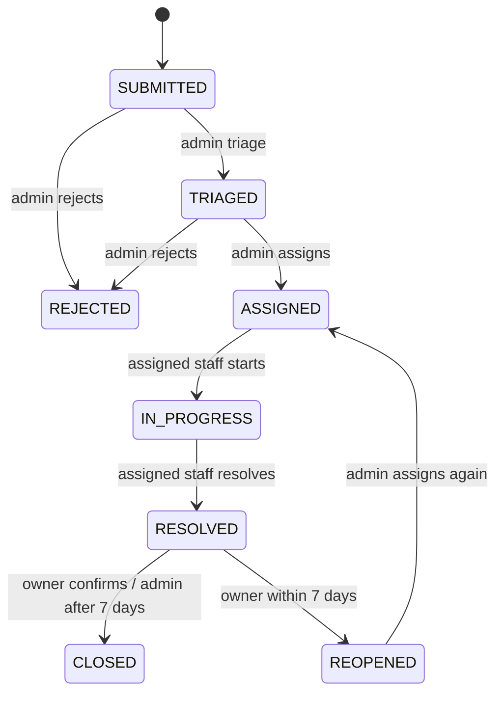

# HostelFix — Product Requirements Document

**Version:** 1.0 · **Planning date:** October 18, 2026 · **Prototype and presentation target:** October 21, 2026 (Asia/Kolkata)

**Document status:** Implementation baseline. This task defines the application; it does not implement it. All requirements below describe planned behavior, not existing functionality.

**Repository inspection:** The repository root contained only an empty `prd.md`; there was no application, README, package manifest, Git repository, or applicable `AGENTS.md`. Use the stack and structure specified here. Only this document is created/updated during planning.

**Interpretation:** MUST/required means binding for the stated priority. P0 is the demo release gate; P1 is designed here but can ship after P0; P2 is deferred. Dates and the possible October 22–23 feature challenge come from the project brief, not verified official hackathon rules. Do not describe HostelFix as AI-powered: its MVP prioritization and similarity matching are deterministic.

## 1. Product overview

HostelFix is a hostel maintenance platform that takes a student's report through triage, staff assignment, work, resolution, and student confirmation. Students can see what happened and who acted; maintenance staff have a clear work queue; hostel administrators can identify unassigned, urgent, and overdue work.

The differentiator is a complete operational workflow with enforceable permissions, recorded decisions, deadlines, and a persistent activity timeline. Success is a deployed demonstration in which separate student, staff, and administrator accounts complete this workflow against real database records.

The default implementation is JavaScript using Next.js App Router, React, Tailwind CSS, Node.js, Express, MongoDB/Mongoose, and Zod. Frontend and backend deploy separately. REST resources live under `/api/v1`. Store photos through a private storage interface, initially backed by a persistent local directory. Use Vitest and Supertest for backend tests and Playwright for one critical browser journey.

## 2. Problem statement and objectives

Informal messages and paper registers lose complaint context, leave ownership unclear, and make students repeatedly ask for updates. Administrators lack reliable visibility into backlog and technicians lack a consistent assignment queue.

| Objective | Release evidence / target |
|---|---|
| Make reporting fast | A student familiar with the form submits a valid report with a photo in under two minutes on mobile. |
| Make ownership explicit | Every `ASSIGNED`/`IN_PROGRESS` complaint has exactly one eligible staff assignee. |
| Make progress transparent | Every successful workflow action writes an immutable activity event atomically with its state change. |
| Enforce hostel isolation | Integration tests prove students cannot read other students' complaints, staff cannot read unassigned complaints, and administrators cannot cross their hostel scope. |
| Make the demo reliable | The P0 browser journey passes against the deployed environment; seed/reset instructions can reproduce the demo. |
| Expose delays | P0 computes response/resolution deadlines and overdue queues; P1 adds recorded escalations and historical reporting. |

Do not present seeded metrics as measured product impact. Real adoption, reduced resolution time, and satisfaction improvements require a pilot after the hackathon.

## 3. Target users and personas

| Role | Persona and needs | Scope |
|---|---|---|
| `STUDENT` | Resident reporting a broken fan or water problem from a phone; needs quick submission, updates, and recourse if a repair fails. | One active hostel and assigned room; own complaints only. Can report their room, common areas in their block, or hostel-wide common areas. |
| `STAFF` | Maintenance worker responsible for one hostel and a configured set of complaint categories; needs actionable assignments and public work updates. | Currently assigned complaints in their hostel, including assigned historical complaints until reassignment. |
| `ADMIN` | Warden or hostel manager triaging reports, allocating staff, and monitoring delays. | One or more explicitly assigned hostel IDs. No implied institution-wide access. |

Accounts have one role. Role selection is never accepted from public registration. No super-admin UI is required; the seed/operations command provisions administrator scope. Accounts cannot transfer hostels through profile editing in the MVP.

## 4. Scope and exclusions

**P0 release:** student registration/login/session refresh/logout, profiles and password change, scoped location/category reads, complaint submission with up to three photos, own/scoped lists and details, edit-before-triage, triage/rejection, assignment/reassignment, work progress and resolution, student close/reopen/feedback, comments, immutable activity, configurable policy stored in seeds, SLA deadlines and overdue filters, basic role dashboards, centralized validation/errors, secure uploads, reproducible seed data, tests, and deployment. ("Session recovery" in this document means the silent JWT refresh flow described in §13; email-based password recovery is a P2 exclusion.)

**P1 release:** duplicate suggestions and administrator linking, durable in-app notifications, automatic/manual escalations, detailed analytics, staff/account management, category/location maintenance, policy editing, and operational retry/cleanup improvements beyond the P0 baseline. These have explicit contracts so they can be added without redesigning P0.

**P2 exclusions:** machine learning/LLM classification, predictive maintenance, email/SMS/push delivery, SSO, verified institutional enrollment, password recovery by email, live chat, WebSockets, offline mode, procurement/inventory, cost accounting, technician routing, native apps, public complaint feeds, multi-institution tenancy, complaint deletion, bulk merges, and automatic resolution/closure. No payment or medical/emergency dispatch capability is implied.

P0 uses seeded hostels, blocks, rooms, categories, staff, administrator scopes, and policies. P1 administrative configuration screens may be deferred without blocking the core workflow. A staff resolution never silently closes a complaint.

## 5. Functional requirements

| ID | Priority | Requirement / implementation decision |
|---|---|---|
| AUTH-01 | P0 | Register only students using email, password, profile, a valid location, and a hostel enrollment code. Normalize email; hash passwords and enrollment codes. Registration does not create a session. |
| AUTH-02 | P0 | Login returns a short-lived access JWT and sets a rotating opaque refresh cookie. Verify account and session status on every protected request. Logout revokes the session immediately. |
| AUTH-03 | P0 | Profile edits allow only name and optional phone. Password change verifies the old password and revokes every session. Seeded or provisioned staff may be forced to change an initial password. |
| AUTH-04 | P0 | Enforce role, resource ownership, hostel scope, active references, and staff eligibility on the server. Treat client role/navigation as presentation only. |
| CMP-01 | P0 | Create a uniquely referenced complaint with title, category, description, location, four priority indicators, and optional validated attachment IDs. Make create retries idempotent using a client UUID. |
| CMP-02 | P0 | Provide scoped pagination, filters, search, details, public comments, and chronological activity. A student may edit report content only while `SUBMITTED`. |
| FLOW-01 | P0 | Enforce the state machine in section 7 through dedicated commands. Require notes/reasons where specified and optimistic concurrency on every complaint mutation. |
| FLOW-02 | P0 | Administrators triage, assign/reassign, reject, and override priority. Eligible assigned staff begin work and resolve with a resolution note. |
| FLOW-03 | P0 | Owners confirm closure, reopen within the defined window, and leave one feedback record for the latest final resolution. |
| SLA-01 | P0 | Snapshot the hostel's SLA policy, compute UTC deadlines, track first human response per cycle, and query overdue complaints without relying on a scheduler. |
| DASH-01 | P0 | Show scoped complaint status counts, recent complaints, latest activity, and workload/overdue summaries using dedicated aggregation endpoints. |
| OPS-01 | P0 | Use consistent validation/errors, secure private file access, request IDs, transactions, bounded queries, structured logs, readiness checks, and an explicit seed command. |
| DUP-01 | P1 | Suggest deterministic similarity matches and let administrators link/unlink duplicates with reasons. Never discard or close a complaint automatically. |
| NOT-01 | P1 | Create private in-app notifications from durable events, deduplicate delivery, and track read state. |
| SLA-02 | P1 | Run idempotent escalation processing and support administrator escalation with a note. |
| ADMIN-01 | P1 | Manage scoped staff, account status, categories, locations, and SLA/priority policy under referential-integrity constraints. |
| ANA-01 | P1 | Aggregate category/priority/status distribution, resolution duration, trends, feedback, and staff workload with documented date semantics. |

Every P0 requirement maps to acceptance scenarios in section 17. Later-priority routes must not be shown as usable controls until implemented; P0 pages hide P1 actions instead of displaying nonfunctional buttons.

## 6. User journeys and workflows

### 6.1 Student submission and tracking

1. Student obtains the hostel enrollment code through the demo/institution, selects a seeded hostel/block/room, registers, and logs in.
2. Dashboard shows their counts, recent reports, and latest updates. The complaint form defaults to their room and offers permitted common-area locations.
3. Student chooses an active category, writes a title/description, answers concrete priority questions, and optionally uploads photos. The UI explains the suggested priority and emergency guidance for safety risks.
4. Submit creates a `SUBMITTED` complaint, public reference, SLA cycle, and `CREATED` activity. Navigate to detail. A repeated submit with the same client UUID returns the same complaint.
5. Student follows the timeline and adds information using comments. In P1, status/comment notifications link back to this page.
6. Once staff resolve it, the student either confirms closure or reopens with an explanation within seven days. Feedback is available only for a resolved/closed complaint that has not been reopened after feedback submission.

### 6.2 Administrator triage and assignment

1. Administrator opens the scoped untriaged/overdue list, checks location, category, safety indicators, and photo.
2. Administrator records triage or rejects a non-maintenance/invalid report with a public reason. Duplicate resemblance alone is not a rejection reason.
3. Administrator reviews priority and changes it with a recorded reason if needed.
4. Administrator chooses active, eligible staff in the same hostel. Assignment changes status to `ASSIGNED`; reassignment records old/new assignee and reason.
5. Overdue queues remain visible even if the P1 escalation worker is disabled. In P1, the administrator can inspect suggestions, link duplicates, and investigate escalations.

### 6.3 Staff completion

1. Staff opens their assigned work queue sorted by overdue first, priority rank descending, then oldest creation.
2. Staff begins work (`IN_PROGRESS`), writes student-visible progress comments, and marks work resolved with a concrete resolution note.
3. The complaint remains `RESOLVED` until student confirmation or administrator closure after the response window. The latest resolution duration is captured; feedback belongs to that resolution cycle.

### 6.4 Failure and concurrency paths

- Validation errors preserve the form and identify fields. Failed uploads can be retried or removed before submission.
- A stale complaint version returns `409 VERSION_CONFLICT`; the UI reloads current data and asks the user to review/reapply. Do not silently retry workflow mutations.
- A session expiry triggers one coordinated refresh and one retry of a read request. Mutations use their command's safe retry rules; a refresh failure returns to login with a safe relative return path.
- An unavailable assignee/category/location causes a specific `409` or `422`, never a partially applied command.
- P1 notifications can arrive later; complaint detail/activity is always the source of truth.

## 7. Complaint lifecycle and business rules

### 7.1 State machine

Use exactly `SUBMITTED`, `TRIAGED`, `ASSIGNED`, `IN_PROGRESS`, `RESOLVED`, `CLOSED`, `REOPENED`, and `REJECTED`. `OPEN_STATUSES = [SUBMITTED, TRIAGED, ASSIGNED, IN_PROGRESS, REOPENED]`; `TERMINAL_STATUSES = [CLOSED, REJECTED]`. `RESOLVED` means work completed and awaiting confirmation; it is excluded from active SLA backlog.



| From → to | Command / actor | Preconditions and required note |
|---|---|---|
| none → `SUBMITTED` | Create / student | Active account and references; authorized location; all content validated. |
| `SUBMITTED` → `TRIAGED` | Transition / scoped admin | `note` 10–2,000 characters. Counts as first response. |
| `SUBMITTED` or `TRIAGED` → `REJECTED` | Transition / scoped admin | `note` 10–2,000; `rejectionCode` is `OUT_OF_SCOPE`, `INVALID_LOCATION`, or `INSUFFICIENT_INFORMATION`. No rejection after assignment. A new corrected report is allowed. |
| `TRIAGED` or `REOPENED` → `ASSIGNED` | Assignment / scoped admin | Eligible staff, `note` 10–2,000. First assignment of a reopened cycle counts as its first response. |
| `ASSIGNED` → `IN_PROGRESS` | Transition / current assigned staff | `note` 10–2,000 describing commencement. |
| `IN_PROGRESS` → `RESOLVED` | Transition / current assigned staff | `resolutionNote` 20–2,000 describing the action and result. Record `resolvedAt`, resolver, cycle, duration. |
| `RESOLVED` → `CLOSED` | Transition / owner; scoped admin only after seven days | Owner: `note` 5–2,000 confirming success. Admin: `note` 10–2,000; only when `now > reopenUntil`. No scheduled auto-close. |
| `RESOLVED` → `REOPENED` | Reopen / owner only | `reason` 20–2,000, `now <= reopenUntil`, `reopenCount < 2`. Start a new SLA cycle, clear assignee/current resolution fields, and invalidate existing feedback as described below. |

All other status transitions return `409 INVALID_TRANSITION` after authorization. `CLOSED` and `REJECTED` cannot be reopened; the UI explains that closure is final and a new complaint may be created. Administrators cannot impersonate staff resolution or a student's confirmation. Staff cannot reject, close, reopen, triage, or assign.

### 7.2 Assignment, content, and notes

- A complaint has zero or one current assignee. Assignment is separate from the generic transition endpoint to validate staff and audit allocation together. There is no unassign command in the MVP.
- Reassign only in `ASSIGNED` or `IN_PROGRESS`. A different eligible assignee is required, and the status becomes/remains `ASSIGNED`. Reset `workStartedAt` for the new attempt, preserve previous activities and the existing SLA cycle/deadlines. Record a reason and old/new assignee. Reassigning the same staff member returns `409 ALREADY_ASSIGNED`.
- Staff must be active, belong to the complaint's hostel, and include its category in `categoryIds`. A staff account with open assignments cannot be deactivated or have relevant categories removed until those complaints are reassigned. Historical assigned complaints may remain linked to inactive staff.
- Only the owning student can `PATCH` content, and only in `SUBMITTED`. Editable fields: title, description, categoryId, location, and indicators. Owner, reference, assignee, status, timestamps, feedback, attachments, and SLA fields are never patchable. To correct attachments later, submit contextual comments; post-submission attachment editing is deferred.
- All comments/work notes are public to the complaint's authorized readers. There is no internal-note field whose contents could accidentally leak. Comments are append-only; no comment deletion/editing in the MVP.
- Owner, current assigned staff, and scoped admins can comment in any nonterminal state. Closed/rejected complaints are read-only except authorized duplicate annotations, feedback on closed complaints, and audit retrieval.
- All command notes are visible in the activity timeline; security/account audit events are separate and never embedded in a student-visible timeline.

### 7.3 Resolution, reopen, feedback, and deadlines

- At each resolution, set `reopenUntil = resolvedAt + 7 × 24 hours`. All timestamps are UTC; UI displays local time. Use server time for boundaries.
- Reopening increments `reopenCount` and `cycleNumber` (initial cycle is 1; maximum is 3), preserves bounded previous cycle summaries, clears current assignee, and starts new response/resolution clocks at `reopenedAt` using the currently configured policy. Previous SLA breaches and resolutions remain auditable.
- Feedback is one record per complaint: rating integer 1–5, optional comment up to 1,000 characters, author is the owner, and it references the current resolved cycle. Only `RESOLVED`/`CLOSED` accepts feedback. A second submission for the same valid cycle returns `409 FEEDBACK_EXISTS`.
- Reopen sets an existing feedback record `isCurrent=false` atomically. Submitting feedback after the next resolution replaces the feedback document's current values and cycle; immutable `FEEDBACK_SUBMITTED` events preserve earlier ratings/comments. Analytics includes only `isCurrent=true`. A feedback submission is not a closure command.
- Administrators can change priority on open complaints only, with a reason. `suggestedPriority` remains distinct from `priority`; `prioritySource` is `RULE` or `ADMIN`. Recompute suggestions on permitted content edits; preserve any administrative override.
- For a priority change/content edit, calculate candidate deadlines from the current cycle's start and its snapshotted SLA targets. Apply `min(existingDeadline, candidateDeadline)` so reprioritization cannot erase lateness or extend a promised deadline. Record old/new priority and deadlines. A new global policy affects new cycles only. Deadline extensions are deferred.

### 7.4 Atomicity, concurrency, and retry rules

- Each complaint has integer `version`, initially 1. Every mutation, including comments, feedback, and duplicate annotations, requires `expectedVersion` and increments the version inside a transaction with its activity records and associated documents. Fetches return the current version.
- Load the complaint through an authorized database predicate first. Validate the command, then update using `{_id, version: expectedVersion}`. A zero-match update is `409 VERSION_CONFLICT`; do not leak an inaccessible complaint's existence.
- Use MongoDB replica-set transactions in development/test/production; standalone MongoDB is unsupported. Implement bounded retry for transient database transaction conflicts, rechecking version and permissions; never retry arbitrary client actions as new actions.
- Assignment/provisioning changes also update the eligible staff user's `version` as a transaction guard. Deactivation/category changes take the same guard, check active assignments, and revoke sessions atomically. This prevents assignment racing with account disablement.
- Reference deactivation and creation/edits using that reference acquire a write guard (`version` increment) on the reference record in the transaction. Do not rely on a read-only check to prevent races. Administrative configuration writes are low volume.
- `clientRequestId` is a UUID required on complaint creation, unique per owner. Store a canonical validated input hash, with attachment IDs in stable order. Same owner/key/hash returns the original complaint with HTTP 200 and `meta.idempotentReplay=true`; a different payload returns `409 IDEMPOTENCY_CONFLICT`. Resolve this lookup before rechecking consumed attachment state, while still checking current owner/account authorization. First success returns 201.
- Other commands have version-based at-most-once state effects. If a response is lost, refetch detail/activity before retrying. A stale repeated command must not produce a second comment, feedback, assignment, or transition.

## 8. Role-permission matrix

Legend: **Own** = owning student; **Assigned** = current assignee in the same hostel; **Scoped** = complaint/reference hostel is in `adminHostelIds`; **Self** = authenticated account. An inactive account is denied all protected access. A resource outside the caller's permitted scope returns 404; a disallowed action on an accessible resource returns 403.

| Capability | Student | Staff | Admin | Additional restrictions |
|---|---|---|---|---|
| Read/update own profile; change password | Self | Self | Self | Field allowlist; no role/scope changes. |
| Register account | Student only | No | No | Staff/admin cannot self-register. |
| Submit complaint / stage photo | Yes | No | No | Student's permitted locations only. |
| List/read complaint, activity, comments, attached photos | Own | Assigned | Scoped | Apply scope before filters/search/aggregation. |
| Edit report content | Own | No | No | `SUBMITTED` only. |
| Add public comment | Own | Assigned | Scoped | Nonterminal state; expected version. |
| Triage/reject | No | No | Scoped | Exact transition table applies. |
| Assign/reassign | No | No | Scoped | Eligible staff and transition restrictions. |
| Begin work / resolve | No | Assigned | No | Exact transition table applies. |
| Change effective priority | No | No | Scoped | Open only; reason required. |
| Reopen | Own | No | No | Resolved, within seven days, maximum two. |
| Confirm close | Own | No | Scoped | Admin only after reopen window. |
| Submit feedback | Own | No | No | Latest resolved/closed cycle only. |
| Duplicate suggestions | Own candidates | No | Scoped candidates | Student results never reveal another student's complaint. |
| Link/unlink duplicates; escalate | No | No | Scoped | Both complaints scoped and same hostel; explicit reasons. |
| Read role dashboard | Own | Assigned | Scoped | Every metric uses the same scope predicates as lists. |
| Read notifications / mark read | Self | Self | Self | Stale links are reauthorized when followed. |
| Read active category/location catalog | Own hostel + registration directory | Own hostel | Scoped | Public directory contains IDs/names only, no occupants. |
| List staff for assignment | No | No | Scoped | Eligible filters; safe user projection. |
| Manage staff/student account status | No | No | Scoped | Cannot manage admins, change student room, or move staff hostels. |
| Manage categories, rooms, blocks, hostel policy | No | No | Scoped | No hard deletion or cross-hostel references. |
| Create hostels/admin scope or change roles | No | No | No | Explicit seed/operations task, outside HTTP MVP. |

Enforcement order: request limits/validation → authentication/session/account → role gate → scoped resource query → state/business checks → transaction. Query filters cannot replace or widen the server-derived scope. A forged `ownerId`, `hostelId`, `role`, or `$` operator is rejected, never trusted.

## 9. Complete API route specification

### 9.1 Shared transport and response contract

All paths below are under `/api/v1`; the tables use complete paths. JSON is UTF-8, strict Zod objects reject unknown keys, and the default JSON body limit is 32 KiB. Multipart is allowed only on the upload endpoint. Use HTTPS outside localhost.

**Authentication labels:** `Public` = no access JWT required; `Refresh` = refresh cookie plus CSRF controls; `S`, `F`, `A` = active student, staff, admin bearer JWT plus current database session. Every cookie-using mutation validates allowed `Origin` and `X-CSRF-Protection: 1`; the frontend sends both for every mutation. State-changing requests with missing/untrusted origin are rejected outside explicitly configured non-browser test clients. Do not whitelist by arbitrary user-agent.

**Success:** `{ "data": <object|array>, "meta": { "requestId": "uuid", ... } }`. All dates are ISO-8601 UTC strings, IDs are serialized MongoDB ObjectId strings, enums are uppercase, nullable fields are explicit `null`. 204 responses have no body. Failures use `{ "error": { "code": "CODE", "message": "Safe message", "fields": [{"path":"description","message":"..."}], "requestId":"uuid" } }`; omit `fields` when not applicable. No stack traces, SQL/Mongo errors, password/session hashes, storage keys, or raw refresh tokens appear in responses.

**Pagination:** `page` integer default 1, min 1, max 1,000; `limit` integer default 20, range 1–100. Lists return `data: []` and `meta: {requestId,page,limit,total,totalPages}`; `totalPages=0` for no results. Bound deep offsets to 100,000; keyset pagination is a later optimization. Always append `_id` as a stable sort tie-breaker. Empty pages return 200. Reject unknown query parameters and invalid sort names with 422.

**Common errors on protected routes:** 401 `AUTH_REQUIRED`, `TOKEN_EXPIRED`, or `SESSION_INVALID`; 403 `ACCOUNT_INACTIVE`, `PASSWORD_CHANGE_REQUIRED`, `FORBIDDEN`, or `CSRF_INVALID`; 404 `NOT_FOUND` for missing/out-of-scope resources; 422 `VALIDATION_ERROR`; 429 `RATE_LIMITED` with `Retry-After`; 503 `SERVICE_UNAVAILABLE`. Invalid JSON is 400 `MALFORMED_JSON`, oversized body is 413 `PAYLOAD_TOO_LARGE`. Complaint mutations additionally use 409 `VERSION_CONFLICT`; config/user mutations also require expected versions. These common rules apply to every applicable row; row error lists add business-specific cases.

**Reusable request types:**

- `Id`: exactly 24 hexadecimal characters; UUID inputs must be RFC 4122 UUIDs. `Version`: integer ≥1. Reject invalid IDs with 422 before database access.
- `Name`: trimmed 2–80 characters; `Email`: trim/lowercase, valid syntax, max 254; `Password`: 12–128 characters and at most 256 UTF-8 bytes, no trim/truncation, accept spaces/Unicode. Never echo passwords. `Phone`: nullable E.164 `+` followed by 8–15 digits.
- `Location`: `{type,hostelId,blockId?,roomId?,areaLabel?}`. `ROOM` requires matching hostel/block/room, forbids areaLabel; `BLOCK_COMMON` requires hostel/block and areaLabel 3–80, forbids roomId; `HOSTEL_COMMON` requires hostel and areaLabel 3–80, forbids blockId/roomId. Student room/block must match their profile; hostel must always match. All referenced documents must be active for new/edited complaints.
- `Indicators`: exactly four booleans: `safetyRisk`, `essentialServiceOutage`, `affectsMultipleRooms`, `functionalityLoss`. No free-form priority field at creation.
- `ComplaintInput`: title 8–120, description 20–4,000, active `categoryId` in the chosen hostel, valid `location`, `indicators`, `attachmentIds` unique array of 0–3 owned staged uploads, `clientRequestId` UUID.
- `ComplaintFilters`: optional `status` comma-separated up to eight known states, `categoryId`, `priority`, `hostelId`, `blockId`, `roomId`, `assigneeId` (admin only), `overdue` = `response|resolution|any`, `unassigned=true` (admin only), `duplicate` = `linked|unlinked` (P1), `q` 2–100 characters, `createdFrom`/`createdTo` ISO UTC inclusive/exclusive. Dates must be ordered and span ≤366 days. `q` searches normalized public reference exactly or escaped literal title substring; no raw regex. Default sort `createdAt:desc`; allow `createdAt:asc`, `updatedAt:desc`, `priority:desc`, `resolutionDueAt:asc`. Staff queues also allow `workQueue` with ordering defined in section 15. Scope mismatches in requested IDs return 404; forbidden filter fields return 422.
- `DashboardFilters`: same authorized location/category/priority/status/date filters, without pagination/search/sort. Date defaults and metric semantics appear in section 15. Do not accept `ownerId` from any dashboard client.

**Reusable response projections:**

- `UserSelf`: id, name, email, phone, role, status, mustChangePassword, hostelId/blockId/roomId as applicable, adminHostelIds or categoryIds as applicable, version, createdAt. Never include passwordHash or enrollment code. `StaffSummary`: id, name, hostelId, categoryIds, status, version, openAssignedCount; email appears only in administrator staff-management responses.
- `ComplaintSummary`: id, reference, title, category `{id,name}`, safe location labels/IDs, status, priority, suggestedPriority, prioritySource, assignee `{id,name}|null`, createdAt, updatedAt, cycleNumber, version, responseDueAt, resolutionDueAt, isResponseOverdue, isResolutionOverdue. No owner contact details in list responses.
- `ComplaintDetail`: summary plus description, indicators, priorityExplanation, owner `{id,name}` (no email/phone), attachment metadata, currentCycle, priorCycles, resolutionNote/resolvedAt/reopenUntil or null, reopenCount, feedback projection or null, duplicate relation projection, and `allowedActions`. `allowedActions` is advisory for UI; commands recheck rules. Exclude storage internals and old invalid feedback except from the authorized activity timeline.
- `ComplaintCommandResult`: `{complaint: ComplaintDetail, activity: Activity}`. For comments add `comment: Comment`; for feedback add `feedback: Feedback`. This returns the new version without another read.
- `Activity`: id, complaintId, type, actor `{id,name,role}|null` (null = system), occurredAt, previousStatus/newStatus or null, note or null, allowlisted change payload. `Comment`: id, complaintId, author `{id,name,role}`, body, createdAt. `Attachment`: id, originalName, mimeType, sizeBytes, width, height, and private content endpoint URL.

### 9.2 Authentication and profiles (P0)

| Method and endpoint | Purpose / auth | Input and specific validation | Success | Additional errors |
|---|---|---|---|---|
| `POST /api/v1/auth/register` | Student registration; Public + origin/header controls | `{name,email,password,phone?,hostelId,blockId,roomId,enrollmentCode}`; enrollmentCode 8–64; active matching location; compare hashed hostel code; forbid role/status/scope fields. | 201 `{user: UserSelf}`; no tokens/cookie. | 409 `EMAIL_IN_USE`; 422 `ENROLLMENT_INVALID` for incorrect code or inactive/mismatched registration location, without revealing which secret check failed. |
| `POST /api/v1/auth/login` | Create session; Public + origin/header controls | `{email,password}`; same normalization/length limits; generic credential errors; reject inactive accounts after credential check. | 200 `{user,accessToken,expiresIn:600}` + rotating-cookie session described in section 13. | 401 `INVALID_CREDENTIALS`; 403 `ACCOUNT_INACTIVE`; 429 throttle. |
| `POST /api/v1/auth/refresh` | Rotate current refresh token; Refresh | Empty JSON `{}`; cookie required; no role/body token accepted. Validate token hash, family/session, expiry and account. | 200 `{user,accessToken,expiresIn:600}` + replacement refresh cookie. | 401 `SESSION_INVALID`/`REFRESH_REUSE_DETECTED`; clear cookie and revoke family on reuse. |
| `POST /api/v1/auth/logout` | Revoke current session; Refresh or bearer | Empty JSON; origin/header controls even if session is absent. Revoke session addressed by valid cookie or bearer sid; clear cookie at identical attributes. | 204, including already missing/revoked session. | 403 CSRF; infrastructure failure is 503, never a false successful server revocation. |
| `GET /api/v1/auth/me` | Current authentication state; S/F/A | No body/query. Allowed when password change is required. | 200 `{user: UserSelf}`. | Common errors. |
| `GET /api/v1/users/me` | Profile screen; S/F/A | No body/query; same projection as auth/me. | 200 `{user: UserSelf}`. | Common errors. |
| `PATCH /api/v1/users/me` | Profile update; S/F/A | `{expectedVersion,name?,phone?}`; at least one editable field. Email/role/location/status/password are forbidden. | 200 `{user: UserSelf}` with incremented version. | 409 `VERSION_CONFLICT`. |
| `POST /api/v1/users/me/password` | Change own password; S/F/A, including forced-change session | `{currentPassword,newPassword}`; verify old password; reject identical new value; password validation. | 204; clear refresh cookie, revoke all sessions, require fresh login. | 401 `INVALID_CREDENTIALS`; 422 `PASSWORD_UNCHANGED`. |

`auth/me` and `users/me` intentionally share one self-profile service: the former bootstraps auth, the latter is a stable profile resource. Forced-password-change sessions can call only these two GETs, password change, refresh, and logout.

### 9.3 Catalog and private upload routes (P0)

| Method and endpoint | Purpose / auth | Input and specific validation | Success | Additional errors |
|---|---|---|---|---|
| `GET /api/v1/catalog/hostels` | Registration choices; Public | Pagination; only active hostels; no arbitrary filters. | 200 paginated `{id,name,code}`. | Common public validation/throttle errors. |
| `GET /api/v1/catalog/hostels/:hostelId/blocks` | Registration/location choices; Public | Id; active hostel; embedded active blocks, max 20, no pagination. | 200 array `{id,name,code}`. | 404 inactive/missing hostel. |
| `GET /api/v1/catalog/rooms` | Registration choices; Public | Required hostelId and blockId; pagination; active matching references; sort room label ascending. | 200 paginated `{id,hostelId,blockId,label}`; no occupants or occupancy counts. | 404 inactive/missing parent. |
| `GET /api/v1/categories` | Complaint/assignment categories; S/F/A | Required hostelId; optional `includeInactive=true` for admin only; pagination, name ascending. Validate caller hostel scope. | 200 paginated `{id,hostelId,code,name,description,isActive,version}`. | 403 inactive-category access by non-admin; 404 out of scope. |
| `POST /api/v1/uploads` | Stage a complaint photo; S | Multipart exactly one `file`; ≤5 MiB input, JPEG/PNG/WebP only, decoded ≤12 megapixels and ≤6,000px per dimension; max ten unattached uploads per owner. | 201 `{attachment: Attachment,expiresAt}`. | 413 `FILE_TOO_LARGE`; 415 `UNSUPPORTED_MEDIA_TYPE`; 422 `INVALID_IMAGE`; 409 `UPLOAD_QUOTA_EXCEEDED`; 503 `STORAGE_UNAVAILABLE`. |
| `GET /api/v1/uploads/:attachmentId/content` | Stream private photo; staged owner or complaint-authorized S/F/A | Id; load attachment then authorize its bound complaint, or uploader if unattached and not expired. | 200 binary image, accurate type, `Content-Disposition: inline`, `Cache-Control: private, no-store`, `X-Content-Type-Options: nosniff`; not JSON. | 404 inaccessible/expired/missing; 503 missing storage dependency. |
| `DELETE /api/v1/uploads/:attachmentId` | Remove staged upload; S owner | Id; no body; must be unattached. Metadata deletion and storage removal follow cleanup rules. | 204; repeated request after deletion is 404. | 409 `ATTACHMENT_ALREADY_BOUND`; 404 inaccessible. |

The public catalog intentionally reveals only building labels/IDs needed for registration; it contains no enrollment codes, room residents, complaint information, or policy secrets. Images must be fetched with the authenticated API client as blobs; the frontend must not use an unauthenticated `` pointing at a bearer-protected URL.

### 9.4 Complaints, comments, and workflow (P0)

| Method and endpoint | Purpose / permitted auth | Input and specific validation | Success | Additional errors |
|---|---|---|---|---|
| `POST /api/v1/complaints` | Submit; S | `ComplaintInput`; bound room/hostel/category; uploaded files owned, unexpired and unattached; owner/status/SLA assigned by server. | 201 `{complaint: ComplaintDetail}`; replay 200 as specified in §7.4. | 409 `IDEMPOTENCY_CONFLICT`, `REFERENCE_INACTIVE`, `ATTACHMENT_ALREADY_BOUND`; 422 `INVALID_REFERENCE`/`ATTACHMENT_INVALID`. |
| `GET /api/v1/complaints` | Scoped list; S Own / F Assigned / A Scoped | Pagination + `ComplaintFilters`; intersect filters with role scope; projections above. | 200 paginated `ComplaintSummary[]`. | 422 unsupported filter/sort; 404 unauthorized referenced scope. |
| `GET /api/v1/complaints/:complaintId` | Detail; S Own / F Assigned / A Scoped | Id; no query/body. | 200 `{complaint: ComplaintDetail}`. | 404 inaccessible; common errors. |
| `PATCH /api/v1/complaints/:complaintId` | Correct original report; S Own only | `{expectedVersion,title?,description?,categoryId?,location?,indicators?}`; at least one field; full validation for changed nested objects; `SUBMITTED` only. | 200 `ComplaintCommandResult` with `CONTENT_UPDATED` event and refreshed priority/deadlines. | 409 `EDIT_WINDOW_CLOSED`, `REFERENCE_INACTIVE`; 422 `INVALID_REFERENCE`. |
| `GET /api/v1/complaints/:complaintId/comments` | Read public discussion; authorized S/F/A | Id + pagination; order createdAt ascending. | 200 paginated `Comment[]`. | Common errors. |
| `POST /api/v1/complaints/:complaintId/comments` | Add follow-up/work note; authorized S/F/A | `{expectedVersion,body}`; trim, 1–2,000; nonterminal; plain text only. | 201 `ComplaintCommandResult` plus `comment`. | 409 `COMPLAINT_READ_ONLY`. |
| `GET /api/v1/complaints/:complaintId/activity` | Full authorized timeline; S/F/A | Id + pagination; ascending occurredAt then id; include immutable public events. | 200 paginated `Activity[]`. | Common errors. |
| `POST /api/v1/complaints/:complaintId/transitions` | Triage/reject/start/resolve/close; actor per §7.1 | `{expectedVersion,toStatus,note?,resolutionNote?,rejectionCode?}` as a discriminated schema. Only TRIAGED, REJECTED, IN_PROGRESS, RESOLVED, CLOSED accepted here; forbid irrelevant fields. | 200 `ComplaintCommandResult`; records previous/new status. | 409 `INVALID_TRANSITION`, `CLOSE_WINDOW_NOT_ELAPSED`; 403 actor cannot perform transition. |
| `POST /api/v1/complaints/:complaintId/assignment` | Assign/reassign; A Scoped | `{expectedVersion,staffId,note}`; note 10–2,000; exact eligible staff and state rules in §7.2. | 200 `ComplaintCommandResult`, safe assignee in detail. | 409 `INVALID_TRANSITION`, `STAFF_INELIGIBLE`, `ALREADY_ASSIGNED`; 404 out-of-scope staff. |
| `POST /api/v1/complaints/:complaintId/priority` | Override priority; A Scoped | `{expectedVersion,priority,reason}`; priority LOW/MEDIUM/HIGH/CRITICAL; reason 10–2,000; open state only. | 200 `ComplaintCommandResult`, updated source/deadlines. | 409 `COMPLAINT_READ_ONLY`, `PRIORITY_UNCHANGED`. |
| `POST /api/v1/complaints/:complaintId/reopen` | Contest repair; S Own | `{expectedVersion,reason}`; 20–2,000; resolved, within window, count <2. | 200 `ComplaintCommandResult`; new cycle, assignee null. | 409 `INVALID_TRANSITION`, `REOPEN_WINDOW_EXPIRED`, `REOPEN_LIMIT_REACHED`. |
| `POST /api/v1/complaints/:complaintId/feedback` | Rate latest resolution; S Own | `{expectedVersion,rating,comment?}`; integer 1–5; comment 0–1,000; current status RESOLVED/CLOSED. | 201 `ComplaintCommandResult` plus feedback (including replacement after a new cycle). | 409 `FEEDBACK_NOT_ALLOWED`, `FEEDBACK_EXISTS`. |

Register literal routes such as `/duplicate-suggestions` before `/:complaintId`. Dedicated action routes deliberately prevent a generic PATCH from changing status, ownership, assignment, or SLA fields.

### 9.5 Duplicate and escalation commands (P1)

| Method and endpoint | Purpose / auth | Input and specific validation | Success | Additional errors |
|---|---|---|---|---|
| `POST /api/v1/complaints/duplicate-suggestions` | Pre-submit or review matches; S/A | `{categoryId,description,location,excludeComplaintId?}` using creation validation; exclusion must be readable. Candidate visibility/scoring in §14. No writes. | 200 `{candidates:[{complaint:ComplaintSummary,score,matchReasons}],algorithmVersion:"token-jaccard-v1"}`; max five. | 404 unauthorized scope/exclusion; 422 invalid input. |
| `POST /api/v1/complaints/:complaintId/duplicate-link` | Link source to canonical; A Scoped on both | `{expectedVersion,canonicalComplaintId,canonicalExpectedVersion,reason}`; reason 10–2,000; distinct IDs, same hostel/category/location match, no chain/cycle, neither rejected. | 200 `{source:ComplaintDetail,canonical:ComplaintDetail}`; versions/activity on both change. | 409 `DUPLICATE_LINK_INVALID`, `DUPLICATE_ALREADY_LINKED`, `VERSION_CONFLICT`. |
| `DELETE /api/v1/complaints/:complaintId/duplicate-link` | Undo link; A Scoped on both | JSON `{expectedVersion,canonicalExpectedVersion,reason}`; 10–2,000; existing link required. | 200 `{source:ComplaintDetail,canonical:ComplaintDetail}`. | 409 `DUPLICATE_LINK_MISSING`, `VERSION_CONFLICT`. |
| `POST /api/v1/complaints/:complaintId/escalations` | Flag urgent intervention; A Scoped | `{expectedVersion,reason}`; 10–2,000; open state; increment current cycle level, maximum 2. Manual action need not be overdue. | 200 `ComplaintCommandResult` with escalation snapshot. | 409 `COMPLAINT_READ_ONLY`, `ESCALATION_LIMIT_REACHED`. |

No destructive merge endpoint is included: linking satisfies duplicate review while preserving each owner's access, SLA, history, feedback, and independent resolution. Linking does not grant permission to read the canonical report. For readers lacking canonical access, detail returns only `{isLinked:true}`; admins/current authorized readers can receive its ID/reference.

### 9.6 Administrative users and references

All routes in this subsection require A and enforce the target hostel's inclusion in `adminHostelIds`. Each mutation records a separate security/config audit event. Staff/room/category IDs are never accepted across hostels. Creation fields are strict; client IDs, role elevation, and arbitrary nested fields are forbidden.

| Method and endpoint | Priority / purpose | Input and specific validation | Success | Additional errors |
|---|---|---|---|---|
| `GET /api/v1/admin/staff` | P0 assignment picker / P1 management list | Required hostelId; optional categoryId, status ACTIVE/INACTIVE; pagination; `eligibleForComplaintId` optional (requires readable complaint in same hostel; implies active + category eligibility). Name ascending. | 200 paginated `StaffSummary[]`; admin list may include email. | 404 scope mismatch; 422 contradictory filters. |
| `POST /api/v1/admin/staff` | P1 provision staff, no email integration | `{name,email,temporaryPassword,hostelId,categoryIds}`; nonempty unique active categories in hostel; password policy. Server fixes role STAFF and mustChangePassword true. | 201 `{user: StaffSummary, mustChangePassword:true}`; never return password. | 409 `EMAIL_IN_USE`, `REFERENCE_INACTIVE`; 422 invalid categories. |
| `PATCH /api/v1/admin/staff/:userId` | P1 manage eligibility/account | `{expectedVersion,name?,categoryIds?,status?}`; at least one; target STAFF in scope; no hostel/email/role/password change; categoryIds nonempty. | 200 `{user:StaffSummary}`; revoke sessions on status change. | 409 `ACTIVE_ASSIGNMENTS_EXIST`, `VERSION_CONFLICT`; 404 nonstaff/out-of-scope. |
| `GET /api/v1/admin/students` | P1 account status support | Required hostelId, optional status, q 2–100 literal name/email search, pagination. | 200 paginated `{id,name,email,hostelId,blockId,roomId,status,version}`. | Common admin errors. |
| `PATCH /api/v1/admin/students/:userId/status` | P1 enable/disable account | `{expectedVersion,status,reason}`; ACTIVE/INACTIVE; reason 10–2,000; target STUDENT in scope. Does not delete complaints or stop staff workflow. | 200 `{user:UserSelf}` excluding irrelevant role fields; revoke sessions on disable. | 409 `STATUS_UNCHANGED`, `VERSION_CONFLICT`. |
| `GET /api/v1/admin/hostels/:hostelId` | P1 inspect managed topology | Id; no query; inactive blocks included. | 200 `{hostel:{id,name,code,isActive,blocks,version}}`; no enrollment hash/code. | 404 scope mismatch. |
| `PATCH /api/v1/admin/hostels/:hostelId` | P1 rename hostel | `{expectedVersion,name}`; 2–80; immutable code. | 200 `{hostel}`. | 409 `VERSION_CONFLICT`. |
| `POST /api/v1/admin/hostels/:hostelId/blocks` | P1 add block | `{expectedVersion,name,code}`; code uppercase alphanumeric/hyphen 1–12, unique within hostel; maximum 20. | 201 `{hostel,block}`; hostel version incremented. | 409 `BLOCK_CODE_EXISTS`, `BLOCK_LIMIT_REACHED`, `REFERENCE_INACTIVE`. |
| `PATCH /api/v1/admin/hostels/:hostelId/blocks/:blockId` | P1 rename/disable block | `{expectedVersion,name?,isActive?}`; block's parent hostel version used; immutable code. Disabling requires no active rooms, resident accounts, or open complaints referring to block. | 200 `{hostel,block}`. | 409 `REFERENCE_IN_USE`, `VERSION_CONFLICT`; 404 unknown block. |
| `GET /api/v1/admin/rooms` | P1 room maintenance list | Required hostelId; optional blockId/isActive; pagination; label ascending. | 200 paginated `{id,hostelId,blockId,label,isActive,version}`. | 404 invalid parent scope. |
| `POST /api/v1/admin/rooms` | P1 add room | `{hostelId,blockId,label}`; active parents; label trimmed uppercase 1–12, `[A-Z0-9-]+`. | 201 `{room}`. | 409 `ROOM_LABEL_EXISTS`, `REFERENCE_INACTIVE`. |
| `PATCH /api/v1/admin/rooms/:roomId` | P1 rename/disable room | `{expectedVersion,label?,isActive?}`; no moving parents. Disable only without active residents or open complaints for room. | 200 `{room}`. | 409 `ROOM_LABEL_EXISTS`, `REFERENCE_IN_USE`, `VERSION_CONFLICT`. |
| `POST /api/v1/admin/categories` | P1 create category | `{hostelId,code,name,description?}`; immutable code `[A-Z_]{2,30}`, name 2–60, description ≤300; unique hostel/code. | 201 `{category}`. | 409 `CATEGORY_CODE_EXISTS`, `REFERENCE_INACTIVE`. |
| `PATCH /api/v1/admin/categories/:categoryId` | P1 rename/disable category | `{expectedVersion,name?,description?,isActive?}`; no hostel/code edits. Disable only without open complaints; remove inactive category from future picker eligibility without deleting historical staff references. | 200 `{category}`. | 409 `REFERENCE_IN_USE`, `VERSION_CONFLICT`. |
| `GET /api/v1/admin/hostels/:hostelId/policy` | P1 view SLA/priority config | Scoped hostel Id. | 200 `{policy,policyVersion}` using §14 structure. | Common admin errors. |
| `PATCH /api/v1/admin/hostels/:hostelId/policy` | P1 replace policy with audit | `{expectedPolicyVersion,reason,policy}`; reason 10–2,000; complete policy, known priorities/indicators; positive integer minute targets, response ≤ resolution, max 43,200; deadlines cannot be relaxed for higher priority. Escalation fractions 0.25–1, level2 min ≥1 and ≤10,080. | 200 `{policy,policyVersion}` incremented; existing cycles unchanged. | 409 `VERSION_CONFLICT`; 422 `POLICY_INVALID`. |

There are no HTTP hard-delete routes for accounts, complaints, locations, categories, activity, or feedback. Hostel creation/deactivation, student transfers, and changing enrollment codes are explicit operational tasks deferred from the UI; changing codes never exposes their hashes.

### 9.7 Dashboards, reporting, notifications, and health

| Method and endpoint | Priority / auth / purpose | Input and validation | Success shape | Additional errors |
|---|---|---|---|---|
| `GET /api/v1/dashboard/student` | P0 / S / personal overview | `DashboardFilters` constrained to own hostel. | 200 `{asOf,statusCounts,total,open,resolved,closed,rejected,recentComplaints:ComplaintSummary[≤5],latestActivity:Activity[≤10]}`. | Common scoped errors. |
| `GET /api/v1/dashboard/staff` | P0 / F / workload | `DashboardFilters` constrained to assigned complaints; no assigneeId. | 200 `{asOf,statusCounts,total,assignedPending,inProgress,overdueResponse,overdueResolution,overdueAny,queue:ComplaintSummary[≤10]}`. | Common scoped errors. |
| `GET /api/v1/dashboard/admin` | P0 / A / operational overview | `DashboardFilters`; optional permitted hostelId, otherwise all actor scopes. | 200 `{asOf,statusCounts,total,open,resolved,closed,rejected,unassigned,overdueResponse,overdueResolution,overdueAny,staffWorkload:[{staffId,name,assignedPending,inProgress,openAssigned}],recentComplaints:ComplaintSummary[≤5]}`. | Common scoped errors. |
| `GET /api/v1/reports/complaints` | P1 / A / richer analytics | Dashboard filters + required createdFrom/createdTo ≤366 days; `bucket=day|week` default day; `timezone` fixed `Asia/Kolkata` for MVP. | 200 `{asOf,cohort,statusDistribution,categoryDistribution,priorityDistribution,averageResolutionMinutes,resolutionSampleSize,trend,staffWorkload,feedback:{averageRating,sampleSize}}`; exact formulas §15. | 422 invalid range/bucket/timezone. |
| `GET /api/v1/notifications` | P1 / S/F/A / personal inbox | Pagination; `unreadOnly` boolean default false; newest first. | 200 paginated `{id,type,title,message,complaintId|null,createdAt,readAt|null}`. | Common errors; never accept userId filter. |
| `GET /api/v1/notifications/unread-count` | P1 / S/F/A / badge | No params/body. | 200 `{unreadCount}`. | Common errors. |
| `PATCH /api/v1/notifications/:notificationId/read` | P1 / S/F/A owner / mark one | Id; empty `{}`; preserve first readAt; idempotent. | 200 `{notification}`. | 404 nonexistent/another user's notification. |
| `POST /api/v1/notifications/read-all` | P1 / S/F/A / mark visible inbox read | `{through}` ISO UTC ≤now; affects own unread records createdAt ≤through. | 200 `{updatedCount}`; newly arrived records stay unread. | 422 future/invalid cutoff. |
| `GET /api/v1/health` | P0 / Public / process liveness | No input; no external dependency needed. | 200 `{status:"ok"}` + requestId. | Process unavailable is handled by host. |
| `GET /api/v1/health/ready` | P0 / Public / readiness | No input; short-timeout database ping and private-storage writability/readiness check. | 200 `{status:"ready"}`. | 503 `SERVICE_UNAVAILABLE`; no hostnames, paths, credentials, or topology leaked. |

Health probes are exempt from user authentication and normal read limits but receive a separate modest IP cap. Read-all notification operations are bounded by the user's index and retention policy; no global update is allowed.

### 9.8 Example requests and responses

Example IDs are illustrative valid ObjectId strings. JWTs shown as placeholders are never persisted in browser storage. Omitted `meta` fields in explanatory fragments below are still required by the shared contract.

**Login** — `POST /api/v1/auth/login`, JSON and `X-CSRF-Protection: 1`, browser Origin on configured allowlist:

```json
{"email":"student.a@hostelfix.demo","password":"<locally-supplied-demo-password>"}
```

```json
{
  "data": {
    "user": {"id":"670000000000000000000001","name":"Asha Student","email":"student.a@hostelfix.demo","phone":null,"role":"STUDENT","status":"ACTIVE","mustChangePassword":false,"hostelId":"670000000000000000000101","blockId":"670000000000000000000201","roomId":"670000000000000000000301","version":1,"createdAt":"2026-10-18T04:00:00.000Z"},
    "accessToken":"<short-lived-jwt>",
    "expiresIn":600
  },
  "meta":{"requestId":"a8477737-6761-4a73-af9a-b4d6f9c8eace"}
}
```

The response also sets the HttpOnly refresh cookie; its value is absent from JSON. The name is `hf_refresh`; cookie path is `/api/v1/auth`.

**Create** — `POST /api/v1/complaints` with bearer access token:

```json
{
  "clientRequestId":"d39064b2-f3fb-48d7-bd5c-07b090cc7eac",
  "title":"Ceiling fan stopped working",
  "description":"The ceiling fan in my room does not start, even after checking the wall switch.",
  "categoryId":"670000000000000000000401",
  "location":{"type":"ROOM","hostelId":"670000000000000000000101","blockId":"670000000000000000000201","roomId":"670000000000000000000301"},
  "indicators":{"safetyRisk":false,"essentialServiceOutage":false,"affectsMultipleRooms":false,"functionalityLoss":true},
  "attachmentIds":[]
}
```

201 returns a complete `ComplaintDetail`; this representative excerpt shows the essential generated fields:

```json
{
  "data":{"complaint":{
    "id":"670000000000000000000501",
    "reference":"HFX-2026-7KM4Q2P9RX",
    "title":"Ceiling fan stopped working",
    "status":"SUBMITTED",
    "priority":"MEDIUM",
    "suggestedPriority":"MEDIUM",
    "prioritySource":"RULE",
    "priorityExplanation":"Loss of functionality was reported.",
    "assignee":null,
    "cycleNumber":1,
    "version":1,
    "createdAt":"2026-10-18T06:00:00.000Z",
    "responseDueAt":"2026-10-18T14:00:00.000Z",
    "resolutionDueAt":"2026-10-20T06:00:00.000Z",
    "isResponseOverdue":false,
    "isResolutionOverdue":false
  }},
  "meta":{"requestId":"83e5cbb8-91be-4251-bc80-c98f2fe8aef9"}
}
```

**Triage then assign** — after triage has returned version 2:

```json
{"expectedVersion":2,"staffId":"670000000000000000000011","note":"Electrical team to inspect the fan capacitor."}
```

Send this to `POST /api/v1/complaints/670000000000000000000501/assignment`. A 200 command response contains the updated complaint at version 3 plus:

```json
{"id":"670000000000000000000601","complaintId":"670000000000000000000501","type":"ASSIGNED","actor":{"id":"670000000000000000000021","name":"Hostel A Admin","role":"ADMIN"},"occurredAt":"2026-10-18T06:10:00.000Z","previousStatus":"TRIAGED","newStatus":"ASSIGNED","note":"Electrical team to inspect the fan capacitor.","changes":{"previousAssigneeId":null,"assigneeId":"670000000000000000000011"}}
```

**Resolve** — after staff starts work and obtains version 4, send to the transitions endpoint:

```json
{"expectedVersion":4,"toStatus":"RESOLVED","resolutionNote":"Replaced the faulty capacitor and tested the fan at all speed settings."}
```

**Reopen** — owner sends `{"expectedVersion":5,"reason":"The fan stopped again after running for about ten minutes."}` to the reopen endpoint. Success returns version 6, status `REOPENED`, cycleNumber 2, no assignee, and a new SLA snapshot. A feedback action between these commands would have incremented the version, requiring a fresh value.

**Validation failure:**

```json
{"error":{"code":"VALIDATION_ERROR","message":"Some fields need correction.","fields":[{"path":"description","message":"Use 20 to 4000 characters."}],"requestId":"6c1143fc-2a45-4116-9b67-0c3a278e35dc"}}
```

**Version conflict:**

```json
{"error":{"code":"VERSION_CONFLICT","message":"This complaint changed. Refresh it before retrying.","requestId":"bd8f8e38-ffae-4ed7-8740-69edc94cf2ba"}}
```

**Paginated list envelope:**


## 10. Data models and relationships

All collections use Mongoose. Every document has `_id` (ObjectId, auto), `createdAt`, `updatedAt` (Mongoose timestamps), and `version` (Number, default 1, incremented on every mutation inside the command's transaction). String enums are stored uppercase. References use ObjectId with `ref`. Indexes listed are in addition to the `_id` primary key. `unique` means a unique index; `sparse` means the unique constraint skips documents where the indexed field is null. Soft-delete uses `isActive` booleans; hard deletes are not performed.

### 10.1 User

| Field | Type | Constraints |
|---|---|---|
| name | String | required, trim, 2–80 |
| email | String | required, trim, lowercase, unique index, max 254 |
| passwordHash | String | required; never projected to API responses |
| phone | String | nullable, E.164 `+` 8–15 digits |
| role | String enum | `STUDENT`, `STAFF`, `ADMIN`; required, immutable after creation |
| status | String enum | `ACTIVE`, `INACTIVE`; default `ACTIVE` |
| mustChangePassword | Boolean | default false |
| hostelId | ObjectId ref Hostel | required for STUDENT and STAFF; null for ADMIN |
| blockId | ObjectId ref Block | required for STUDENT; null for STAFF/ADMIN |
| roomId | ObjectId ref Room | required for STUDENT; null for STAFF/ADMIN |
| adminHostelIds | [ObjectId] ref Hostel | non-empty for ADMIN only; empty array for others |
| categoryIds | [ObjectId] ref Category | non-empty for STAFF only; empty array for others |
| enrollmentCodeHash | String | nullable; used only at registration verification, never returned |
| version | Number | default 1; incremented on every mutation |

**Indexes:** `{ email: 1 }` unique. `{ hostelId: 1, role: 1, status: 1 }` for scoped staff/student queries. `{ role: 1, status: 1 }` for role-filtered lookups.

**Deletion policy:** Soft-delete via `status: INACTIVE`. Sessions revoked atomically on deactivation. Historical complaint references to deactivated users remain valid for audit; projections use the user's name at time of query.

### 10.2 Session

| Field | Type | Constraints |
|---|---|---|
| userId | ObjectId ref User | required, indexed |
| tokenFamily | String | required; UUID v4 identifying the refresh chain |
| tokenHash | String | required; bcrypt hash of the current opaque refresh token |
| isRevoked | Boolean | default false |
| expiresAt | Date | required; absolute expiry of the refresh token |
| lastRefreshedAt | Date | default createdAt |
| userAgent | String | nullable; truncated to 256 chars |
| ipAddress | String | nullable; stored for audit, not used for validation |

**Indexes:** `{ userId: 1, isRevoked: 1 }` for session listing/revocation. `{ tokenFamily: 1 }` unique. `{ expiresAt: 1 }` with TTL index (expireAfterSeconds: 0) for automatic document cleanup.

**Deletion policy:** Expired sessions are removed by MongoDB TTL. Revoked sessions are kept until TTL expiry for reuse detection.

### 10.3 Hostel

| Field | Type | Constraints |
|---|---|---|
| name | String | required, trim, 2–80 |
| code | String | required, uppercase, immutable, unique, 2–20, `[A-Z0-9-]+` |
| enrollmentCodeHash | String | required; bcrypt hash; never returned in any API response |
| isActive | Boolean | default true |
| version | Number | default 1 |

**Indexes:** `{ code: 1 }` unique. `{ isActive: 1 }`.

### 10.4 Block

**Persistence clarification (2026-10-19, Session 3):** Blocks are separate
documents, as specified in this section. The embedded block arrays in catalog
and hostel responses are projections, not a second stored copy. Block commands
use the client's expected **Hostel** version and increment the parent Hostel
version in the same transaction as the Block write. The Block's own version is
also incremented. Creation/deactivation and reference-use guards follow §7.4;
the maximum of 20 blocks is enforced while holding the parent write guard.

| Field | Type | Constraints |
|---|---|---|
| hostelId | ObjectId ref Hostel | required |
| name | String | required, trim, 2–80 |
| code | String | required, uppercase, 1–12, `[A-Z0-9-]+` |
| isActive | Boolean | default true |
| version | Number | default 1 |

**Indexes:** `{ hostelId: 1, code: 1 }` unique. `{ hostelId: 1, isActive: 1 }`.

### 10.5 Room

| Field | Type | Constraints |
|---|---|---|
| hostelId | ObjectId ref Hostel | required |
| blockId | ObjectId ref Block | required |
| label | String | required, trim, uppercase, 1–12, `[A-Z0-9-]+` |
| isActive | Boolean | default true |
| version | Number | default 1 |

**Indexes:** `{ hostelId: 1, blockId: 1, label: 1 }` unique. `{ hostelId: 1, blockId: 1, isActive: 1 }`.

### 10.6 Category

| Field | Type | Constraints |
|---|---|---|
| hostelId | ObjectId ref Hostel | required |
| code | String | required, uppercase, immutable, 2–30, `[A-Z_]+` |
| name | String | required, trim, 2–60 |
| description | String | nullable, max 300 |
| isActive | Boolean | default true |
| version | Number | default 1 |

**Indexes:** `{ hostelId: 1, code: 1 }` unique. `{ hostelId: 1, isActive: 1 }`.

### 10.7 Complaint

| Field | Type | Constraints |
|---|---|---|
| reference | String | required, unique; generated server-side `HFX-YYYY-<10-char alphanumeric>` |
| ownerId | ObjectId ref User | required, immutable |
| hostelId | ObjectId ref Hostel | required, immutable |
| title | String | required, trim, 8–120 |
| description | String | required, trim, 20–4,000 |
| categoryId | ObjectId ref Category | required |
| location | Embedded | `{ type: enum ROOM|BLOCK_COMMON|HOSTEL_COMMON, hostelId, blockId?, roomId?, areaLabel? }` |
| indicators | Embedded | `{ safetyRisk: Boolean, essentialServiceOutage: Boolean, affectsMultipleRooms: Boolean, functionalityLoss: Boolean }` |
| status | String enum | `SUBMITTED`, `TRIAGED`, `ASSIGNED`, `IN_PROGRESS`, `RESOLVED`, `CLOSED`, `REOPENED`, `REJECTED`; default `SUBMITTED` |
| priority | String enum | `LOW`, `MEDIUM`, `HIGH`, `CRITICAL`; computed at creation |
| suggestedPriority | String enum | same values; always rule-computed |
| prioritySource | String enum | `RULE`, `ADMIN`; default `RULE` |
| priorityExplanation | String | human-readable summary of the scoring reason |
| assigneeId | ObjectId ref User | nullable; current assignee |
| clientRequestId | String | required, UUID, indexed for idempotency |
| clientRequestHash | String | required; SHA-256 of canonical validated input |
| attachmentIds | [ObjectId] ref Attachment | 0–3 |
| cycleNumber | Number | default 1; max 3 |
| reopenCount | Number | default 0; max 2 |
| slaPolicy | Embedded | snapshot of the hostel's SLA policy at cycle start |
| responseDueAt | Date | computed from slaPolicy + cycle start |
| resolutionDueAt | Date | computed from slaPolicy + cycle start |
| firstRespondedAt | Date | nullable; set on first triage/assignment in current cycle |
| resolvedAt | Date | nullable; set when status becomes RESOLVED |
| closedAt | Date | nullable; set when status becomes CLOSED |
| rejectedAt | Date | nullable; set when status becomes REJECTED |
| reopenedAt | Date | nullable; set when status becomes REOPENED |
| reopenUntil | Date | nullable; resolvedAt + 7 days |
| resolutionNote | String | nullable; 20–2,000; set by resolver |
| resolverId | ObjectId ref User | nullable |
| workStartedAt | Date | nullable; set when IN_PROGRESS; reset on reassignment |
| priorCycles | [Embedded] | `[{ cycleNumber, assigneeId, firstRespondedAt, resolvedAt, resolutionNote, resolverId, resolutionDurationMinutes, reopenedAt, reopenReason }]`; max 2 entries |
| rejectionCode | String enum | `OUT_OF_SCOPE`, `INVALID_LOCATION`, `INSUFFICIENT_INFORMATION`; nullable |
| duplicateOfId | ObjectId ref Complaint | nullable; P1 canonical link |
| escalationLevel | Number | default 0; max 2; P1 |
| version | Number | default 1 |

**Indexes:** `{ reference: 1 }` unique. `{ ownerId: 1, status: 1, createdAt: -1 }` for student lists. `{ hostelId: 1, status: 1, createdAt: -1 }` for admin lists. `{ assigneeId: 1, status: 1 }` sparse, for staff queue. `{ ownerId: 1, clientRequestId: 1 }` unique, for idempotency. `{ hostelId: 1, responseDueAt: 1 }` and `{ hostelId: 1, resolutionDueAt: 1 }` for overdue queries. `{ hostelId: 1, categoryId: 1, status: 1 }` for reporting.

**Deletion policy:** No deletion. Terminal states (`CLOSED`, `REJECTED`) are permanent. All historical data preserved for audit.

**Cycle representation clarification (2026-10-19, Session 3):** Current cycle
data remains in the flat Complaint fields above. `ComplaintDetail.currentCycle`
is a projection with `cycleNumber`, `startedAt`, `assigneeId`, `slaPolicy`,
`responseDueAt`, `resolutionDueAt`, `firstRespondedAt`, `resolvedAt`,
`resolutionNote`, `resolverId`, and `resolutionDurationMinutes`. `startedAt` is
`createdAt` for cycle 1 and `reopenedAt` thereafter; duration is
`(resolvedAt - startedAt) / 60000`, or null before resolution. `slaPolicy` is the
complete priority-to-target map from `HostelPolicy.slaTargets`, consistent with
§14.2. Nullable values are explicit nulls.

Each `priorCycles` entry retains these same fields plus the already specified
`reopenedAt` and `reopenReason` describing the action ending that cycle. In
particular, retain the prior start time, snapshotted targets, and final response
and resolution deadlines so earlier breaches remain auditable. Entries are in
cycle order and are never rewritten; at most two are stored. Detail does not
embed a separate unbounded timeline: clients use the paginated activity endpoint
in §9.4. CMP-T15's timeline requirement refers to that combined detail view.

### 10.8 Activity

| Field | Type | Constraints |
|---|---|---|
| complaintId | ObjectId ref Complaint | required |
| type | String enum | `CREATED`, `CONTENT_UPDATED`, `TRIAGED`, `REJECTED`, `ASSIGNED`, `REASSIGNED`, `WORK_STARTED`, `RESOLVED`, `CLOSED`, `REOPENED`, `COMMENT_ADDED`, `PRIORITY_CHANGED`, `FEEDBACK_SUBMITTED`, `DUPLICATE_LINKED`, `DUPLICATE_UNLINKED`, `ESCALATED` |
| actorId | ObjectId ref User | nullable (null = system) |
| actorName | String | snapshot at event time |
| actorRole | String enum | snapshot at event time |
| occurredAt | Date | required; server timestamp |
| previousStatus | String enum | nullable |
| newStatus | String enum | nullable |
| note | String | nullable; the command's note/reason |
| changes | Mixed | nullable; structured change payload (e.g., `{previousAssigneeId, assigneeId}`, `{previousPriority, newPriority}`, `{rating, comment}`) |

**Indexes:** `{ complaintId: 1, occurredAt: 1, _id: 1 }` for timeline pagination. Activities are append-only and immutable after creation.

**Deletion policy:** Never deleted. Immutable audit trail.

### 10.9 Comment

| Field | Type | Constraints |
|---|---|---|
| complaintId | ObjectId ref Complaint | required |
| authorId | ObjectId ref User | required |
| authorName | String | snapshot at creation |
| authorRole | String enum | snapshot at creation |
| body | String | required, trim, 1–2,000 |

**Indexes:** `{ complaintId: 1, createdAt: 1 }` for pagination.

**Deletion policy:** No deletion or editing in MVP. Append-only.

### 10.10 Attachment

| Field | Type | Constraints |
|---|---|---|
| ownerId | ObjectId ref User | required; uploader |
| complaintId | ObjectId ref Complaint | nullable; set when bound to a complaint |
| originalName | String | required; sanitized filename |
| mimeType | String enum | `image/jpeg`, `image/png`, `image/webp` |
| sizeBytes | Number | required; ≤ 5 MiB |
| width | Number | required; ≤ 6,000 |
| height | Number | required; ≤ 6,000 |
| storageKey | String | required; internal path; never exposed in API |
| expiresAt | Date | nullable; TTL for unbound uploads (60 minutes); cleared when bound |

**Indexes:** `{ ownerId: 1, complaintId: 1 }`. `{ expiresAt: 1 }` TTL index (expireAfterSeconds: 0) on unbound uploads. `{ complaintId: 1 }` for complaint attachment lookup.

**Deletion policy:** Unbound uploads are expired by TTL. Bound attachments persist with the complaint. Storage files are cleaned up when metadata expires.

### 10.11 Feedback

| Field | Type | Constraints |
|---|---|---|
| complaintId | ObjectId ref Complaint | required |
| authorId | ObjectId ref User | required; must be complaint owner |
| rating | Number | required; integer 1–5 |
| comment | String | nullable; max 1,000 |
| cycleNumber | Number | required; references the resolution cycle |
| isCurrent | Boolean | default true; set false on reopen |

**Indexes:** `{ complaintId: 1, isCurrent: 1 }` for current feedback lookup. `{ complaintId: 1, cycleNumber: 1 }` unique, ensuring one feedback per cycle.

**Deletion policy:** Never deleted. `isCurrent` flag manages validity. Historical feedback preserved in activity events.

### 10.12 Notification (P1)

| Field | Type | Constraints |
|---|---|---|
| userId | ObjectId ref User | required; recipient |
| type | String enum | `STATUS_CHANGED`, `ASSIGNED`, `COMMENT_ADDED`, `FEEDBACK_RECEIVED`, `SLA_BREACH`, `ESCALATED`, `DUPLICATE_LINKED` |
| title | String | required; ≤ 120 |
| message | String | required; ≤ 500 |
| complaintId | ObjectId ref Complaint | nullable |
| readAt | Date | nullable; set on first read |

**Indexes:** `{ userId: 1, readAt: 1, createdAt: -1 }` for inbox queries. `{ userId: 1, type: 1, complaintId: 1, createdAt: -1 }` for deduplication.

**Deletion policy:** Retained for 90 days; a TTL index on `createdAt` with expireAfterSeconds: 7,776,000 handles cleanup.

### 10.13 HostelPolicy

SLA and priority configuration is stored as a separate collection keyed by hostelId for independent versioning.

| Field | Type | Constraints |
|---|---|---|
| hostelId | ObjectId ref Hostel | required, unique index |
| slaTargets | Embedded | `{ CRITICAL: { responseMinutes, resolutionMinutes }, HIGH: {...}, MEDIUM: {...}, LOW: {...} }` — all positive integers; responseMinutes ≤ resolutionMinutes; higher priority has equal or tighter targets |
| priorityWeights | Embedded | `{ safetyRisk, essentialServiceOutage, affectsMultipleRooms, functionalityLoss }` — positive integers, used by the scoring algorithm in §14 |
| priorityThresholds | Embedded | `{ CRITICAL: Number, HIGH: Number, MEDIUM: Number }` — descending score boundaries |
| escalationConfig | Embedded | P1; `{ level1FractionOfResolution: 0.5, level2Minutes: 1440, autoEscalate: false }` |
| policyVersion | Number | default 1; incremented on every edit |

**Indexes:** `{ hostelId: 1 }` unique.

**Seed defaults** (used when no policy exists):

```json
{
  "slaTargets": {
    "CRITICAL": { "responseMinutes": 120, "resolutionMinutes": 480 },
    "HIGH": { "responseMinutes": 480, "resolutionMinutes": 1440 },
    "MEDIUM": { "responseMinutes": 480, "resolutionMinutes": 2880 },
    "LOW": { "responseMinutes": 1440, "resolutionMinutes": 4320 }
  },
  "priorityWeights": {
    "safetyRisk": 4,
    "essentialServiceOutage": 3,
    "affectsMultipleRooms": 2,
    "functionalityLoss": 1
  },
  "priorityThresholds": {
    "CRITICAL": 7,
    "HIGH": 4,
    "MEDIUM": 1
  }
}
```

---

## 11. Architecture and folder structure

### 11.1 High-level architecture

```
┌──────────────────┐        ┌──────────────────────────┐        ┌──────────────┐
│  Next.js Frontend│───────▶│  Express REST API         │───────▶│  MongoDB     │
│  (Static/SSR)    │  HTTP  │  /api/v1/*               │  Driver│  Replica Set │
│  Port 3000       │◀───────│  Port 5000               │◀───────│  Port 27017  │
└──────────────────┘        │                          │        └──────────────┘
                            │  Private Upload Storage  │
                            │  (local persistent dir)  │
                            └──────────────────────────┘
```

Frontend and backend deploy as separate processes. The frontend communicates exclusively through the REST API. No server-side rendering depends on direct database access.

### 11.2 Backend folder structure

```
backend/
├── src/
│   ├── app.js                    # Express app setup, middleware chain
│   ├── server.js                 # HTTP server, graceful shutdown
│   ├── config/
│   │   ├── env.js                # Environment variable loading and validation
│   │   ├── database.js           # MongoDB connection with replica set
│   │   ├── cors.js               # CORS configuration
│   │   └── storage.js            # Upload storage path configuration
│   ├── middleware/
│   │   ├── authenticate.js       # JWT verification, session validation
│   │   ├── authorize.js          # Role and scope checking factory
│   │   ├── csrf.js               # Origin + X-CSRF-Protection header check
│   │   ├── rateLimiter.js        # Per-IP and per-user rate limiting
│   │   ├── requestId.js          # Attach UUID to every request
│   │   ├── errorHandler.js       # Centralized error → response mapping
│   │   ├── validateBody.js       # Zod schema validation factory
│   │   └── upload.js             # Multer config for single image
│   ├── models/
│   │   ├── User.js
│   │   ├── Session.js
│   │   ├── Hostel.js
│   │   ├── Block.js
│   │   ├── Room.js
│   │   ├── Category.js
│   │   ├── Complaint.js
│   │   ├── Activity.js
│   │   ├── Comment.js
│   │   ├── Attachment.js
│   │   ├── Feedback.js
│   │   ├── Notification.js       # P1
│   │   └── HostelPolicy.js
│   ├── validators/
│   │   ├── auth.validators.js
│   │   ├── complaint.validators.js
│   │   ├── catalog.validators.js
│   │   ├── admin.validators.js
│   │   └── common.validators.js  # Shared Zod schemas (Id, Pagination, etc.)
│   ├── controllers/
│   │   ├── auth.controller.js
│   │   ├── user.controller.js
│   │   ├── catalog.controller.js
│   │   ├── upload.controller.js
│   │   ├── complaint.controller.js
│   │   ├── comment.controller.js
│   │   ├── activity.controller.js
│   │   ├── dashboard.controller.js
│   │   ├── admin.controller.js
│   │   ├── health.controller.js
│   │   ├── notification.controller.js  # P1
│   │   └── report.controller.js        # P1
│   ├── services/
│   │   ├── auth.service.js       # Registration, login, refresh, logout, password
│   │   ├── user.service.js       # Profile read/update
│   │   ├── session.service.js    # Session CRUD, family revocation
│   │   ├── complaint.service.js  # Create, edit, transitions, assign, reopen
│   │   ├── comment.service.js
│   │   ├── feedback.service.js
│   │   ├── upload.service.js     # Stage, bind, stream, cleanup
│   │   ├── dashboard.service.js  # Aggregation pipelines
│   │   ├── catalog.service.js
│   │   ├── priority.service.js   # Deterministic scoring (§14)
│   │   ├── sla.service.js        # Deadline computation, overdue queries
│   │   ├── duplicate.service.js  # P1: similarity scoring
│   │   ├── notification.service.js # P1
│   │   ├── admin.service.js
│   │   └── report.service.js     # P1
│   ├── routes/
│   │   ├── index.js              # Mount all routers under /api/v1
│   │   ├── auth.routes.js
│   │   ├── user.routes.js
│   │   ├── catalog.routes.js
│   │   ├── upload.routes.js
│   │   ├── complaint.routes.js
│   │   ├── dashboard.routes.js
│   │   ├── admin.routes.js
│   │   ├── health.routes.js
│   │   ├── notification.routes.js # P1
│   │   └── report.routes.js       # P1
│   └── utils/
│       ├── AppError.js           # Custom error class with code/status
│       ├── referenceGenerator.js # HFX-YYYY-<random> generator
│       ├── pagination.js         # Parse/apply pagination params
│       ├── scopeBuilder.js       # Build MongoDB query predicates from role
│       ├── hashUtils.js          # bcrypt/SHA-256 helpers
│       └── logger.js             # Structured JSON logging (pino)
├── tests/
│   ├── setup.js                  # In-memory MongoDB replica set, app bootstrap
│   ├── helpers/
│   │   ├── auth.helper.js        # Login/register helpers returning tokens
│   │   ├── seed.helper.js        # Programmatic seed data for tests
│   │   └── request.helper.js     # Supertest wrapper with defaults
│   ├── unit/
│   │   ├── priority.service.test.js
│   │   ├── sla.service.test.js
│   │   └── validators.test.js
│   └── integration/
│       ├── auth.test.js
│       ├── complaint.test.js
│       ├── workflow.test.js
│       ├── dashboard.test.js
│       ├── upload.test.js
│       └── authorization.test.js
├── seeds/
│   ├── index.js                  # Main seed runner
│   ├── data/                     # JSON fixture files
│   └── reset.js                  # Drop and re-seed (dev/demo only)
├── package.json
├── .env.example
└── vitest.config.js
```

### 11.3 Frontend folder structure

```
frontend/
├── src/
│   ├── app/
│   │   ├── layout.js             # Root layout, providers, font loading
│   │   ├── page.js               # Landing / redirect
│   │   ├── (auth)/
│   │   │   ├── login/page.js
│   │   │   └── register/page.js
│   │   ├── (protected)/
│   │   │   ├── layout.js         # Auth guard, sidebar, top bar
│   │   │   ├── dashboard/page.js # Role-based redirect
│   │   │   ├── student/
│   │   │   │   ├── dashboard/page.js
│   │   │   │   ├── complaints/page.js
│   │   │   │   ├── complaints/new/page.js
│   │   │   │   ├── complaints/[id]/page.js
│   │   │   │   └── profile/page.js
│   │   │   ├── staff/
│   │   │   │   ├── dashboard/page.js
│   │   │   │   ├── queue/page.js
│   │   │   │   ├── complaints/[id]/page.js
│   │   │   │   └── profile/page.js
│   │   │   └── admin/
│   │   │       ├── dashboard/page.js
│   │   │       ├── complaints/page.js
│   │   │       ├── complaints/[id]/page.js
│   │   │       ├── staff/page.js          # P1 management; P0 picker is inline
│   │   │       └── profile/page.js
│   │   └── not-found.js
│   ├── components/
│   │   ├── ui/                   # Design system primitives (Button, Input, Card, Badge, etc.)
│   │   ├── layout/               # Sidebar, TopBar, RoleGuard, MobileNav
│   │   ├── complaints/           # ComplaintCard, StatusBadge, Timeline, ComplaintForm
│   │   ├── dashboard/            # StatusCountCard, OverdueAlert, WorkloadTable
│   │   └── common/               # Pagination, EmptyState, ErrorBoundary, LoadingSpinner
│   ├── hooks/
│   │   ├── useAuth.js            # Auth context, token refresh, logout
│   │   ├── useApi.js             # Fetch wrapper with auth headers, error handling
│   │   ├── useComplaints.js      # Complaint list/detail data fetching
│   │   └── useDashboard.js       # Dashboard data fetching
│   ├── lib/
│   │   ├── api.js                # Base API client, interceptors, refresh logic
│   │   ├── constants.js          # Status enums, priority colors, route paths
│   │   └── utils.js              # Date formatting, reference formatting
│   ├── context/
│   │   └── AuthContext.js        # Auth state provider
│   └── styles/
│       └── globals.css           # Tailwind imports + custom design tokens
├── public/
├── package.json
├── next.config.js
├── tailwind.config.js
├── postcss.config.js
└── playwright.config.js
```

### 11.4 Middleware pipeline order

```
requestId → rateLimiter → cors → bodyParser → csrfCheck (mutations) →
  authenticate (protected) → authorize(roles, scopes) → validateBody(schema) →
  controller → errorHandler
```

---

## 12. Frontend screens and UI states

### 12.1 Common patterns

- **Responsive:** Mobile-first; single-column below 768px, sidebar + content above. Touch targets ≥ 44px.
- **Loading:** Skeleton placeholders on data fetch; never a blank white page.
- **Empty:** Illustrated empty state with guidance text (e.g., "No complaints yet. Submit your first report.").
- **Error:** Inline field errors below inputs on 422; toast/banner for 409/500/503 with safe messages from the API `error.message`. Version conflict shows a "Refresh and retry" prompt.
- **Route protection:** The `(protected)/layout.js` checks for a valid access token. Missing or expired tokens trigger a silent refresh attempt; failure redirects to `/login?returnTo=<currentPath>`. Role mismatch redirects to the user's own dashboard. Pages never render protected content before auth completes.
- **Forced password change:** If `mustChangePassword` is true, redirect to a password-change modal/page; block all other navigation until completed.

### 12.2 Public screens

| Screen | Path | Description |
|---|---|---|
| Login | `/login` | Email + password form. Shows generic "Invalid credentials" on 401. Link to register. |
| Register | `/register` | Multi-step or single form: hostel picker (from catalog API) → block → room → enrollment code → name/email/password/phone. Validates client-side and server-side. Success shows "Account created, please log in." with a link. Does not auto-login. |

### 12.3 Student screens

| Screen | Path | Key elements |
|---|---|---|
| Dashboard | `/student/dashboard` | Status count cards (submitted, in-progress, resolved, closed), recent 5 complaints, latest 10 activity items. Overdue badge if any own complaint is overdue. |
| My Complaints | `/student/complaints` | Paginated list with filters (status, category, date range). Search by reference or title substring. Sort controls. Each row: reference, title, status badge, priority badge, dates, assignee name or "Unassigned". Click navigates to detail. |
| New Complaint | `/student/complaints/new` | Category picker, location defaulting to room, title, description textarea with char count, four indicator checkboxes with explanations, photo upload area (drag-drop or click, max 3, preview thumbnails, remove before submit). Client UUID generated on mount. Suggested priority shown after indicators selected. Submit button with loading state. |
| Complaint Detail | `/student/complaints/[id]` | Header: reference, status, priority, assignee, dates. Description and photos (loaded as authenticated blobs). Allowed actions panel: edit (SUBMITTED), comment (nonterminal), close/reopen (RESOLVED), feedback (RESOLVED/CLOSED without current feedback). Activity timeline in chronological order. Comment form. Feedback form (1–5 stars + optional text). Version conflict: reload detail, show diff prompt. |
| Profile | `/student/profile` | Name, email (read-only), phone, hostel/block/room (read-only). Edit name/phone. Change password section. |

### 12.4 Staff screens

| Screen | Path | Key elements |
|---|---|---|
| Dashboard | `/staff/dashboard` | Assigned/pending count, in-progress count, overdue counts. Work queue (top 10) sorted per §6.3. |
| Work Queue | `/staff/queue` | Full paginated list of assigned complaints. Sorted: overdue first, priority desc, createdAt asc. Filter by status (ASSIGNED, IN_PROGRESS). |
| Complaint Detail | `/staff/complaints/[id]` | Same detail layout as student but scoped to assigned. Actions: Start Work (ASSIGNED → IN_PROGRESS), Resolve (IN_PROGRESS → RESOLVED with resolution note textarea 20–2,000 chars). Comment form. No triage/assign/close/reopen controls. |
| Profile | `/staff/profile` | Same as student profile; categories shown read-only. |

### 12.5 Admin screens

| Screen | Path | Key elements |
|---|---|---|
| Dashboard | `/admin/dashboard` | Hostel selector (if multi-hostel). Status counts, open/unassigned/overdue totals. Staff workload table (name, assigned count, in-progress count). Recent 5 complaints. |
| All Complaints | `/admin/complaints` | Full filter panel: status (multi-select), category, priority, assignee, overdue type, unassigned toggle, date range, search. Paginated. |
| Complaint Detail | `/admin/complaints/[id]` | Full detail. Action panel based on state: Triage (SUBMITTED), Reject with code + reason (SUBMITTED/TRIAGED), Assign with staff picker modal (TRIAGED/REOPENED), Reassign (ASSIGNED/IN_PROGRESS), Change Priority with reason, Close after window (RESOLVED). Staff picker shows eligible staff from `GET /api/v1/admin/staff?eligibleForComplaintId=X`. Activity timeline. Comment form. P1 actions (duplicate link, escalate) hidden in P0. |
| Staff Management | `/admin/staff` | P1 screen. P0 uses the inline staff picker on complaint detail only. |
| Profile | `/admin/profile` | Name, email, phone, managed hostels (read-only). |

### 12.6 P1 UI additions (designed, not built in P0)

- Notification bell with unread badge in top bar → dropdown with recent 5 → full inbox page.
- Duplicate suggestion panel on complaint detail (admin view) and new-complaint form (student view, showing only own matches).
- Analytics/reports page with date range selector, charts for distribution and trends.
- Staff/student management tables under admin.
- Category/location management forms under admin.
- Policy editor under admin hostel settings.

---

## 13. Security and non-functional requirements

### 13.1 Password hashing

- Use bcrypt with a work factor of 12. Hash enrollment codes with bcrypt work factor 10.
- Never log, echo, or store plaintext passwords. Timing-safe comparison via bcrypt.compare.

**Full-input hashing clarification (2026-10-19, Session 4; user approved):**
Before bcrypt, compute SHA-256 over the UTF-8 bytes of
`hostelfix:<purpose>:v1\0` followed by the complete, unmodified input, then
base64-encode the digest. The purpose is `password`, `enrollment`, or `refresh`;
`\0` denotes one NUL byte. Bcrypt this 44-character digest at cost 12 for
passwords/refresh secrets and cost 10 for enrollment codes. Verification uses
the same prehash and bcrypt.compare. This applies to every input length and to
future seeds; there is no direct-bcrypt fallback, truncation, normalization of
passwords/codes, or additional secret. Store only the resulting bcrypt hash.

### 13.2 Access JWT

- Algorithm: HS256 with a 256-bit+ secret from `JWT_SECRET` env var.
- Payload: `{ sub: userId, role, sid: sessionId, hostelId, iat, exp }`. Admin tokens include `adminHostelIds`; staff tokens include `categoryIds`.
- Expiry: 10 minutes (600 seconds). Short-lived; no revocation list needed.
- Transmitted in `Authorization: Bearer <token>` header. Never stored in localStorage; the frontend holds it in memory only (React state/context). Lost on page refresh; recovered via the silent refresh flow (§13.3).

### 13.3 Refresh token rotation and reuse detection

**Cookie locator clarification (2026-10-19, Session 4; user approved):**
The single `hf_refresh` cookie contains
`v1.<lowercase UUID-v4 tokenFamily>.<128 lowercase hex characters>`.
The final component is the 64-byte random opaque secret; only its full-input
hash from §13.1 is stored as `tokenHash`. The family is a lookup identifier,
never proof of authentication. Reject malformed or duplicate refresh cookies;
do not accept a family/token in the body, add a second cookie, or scan bcrypt
hashes. Rotation retains the family and the original absolute seven-day
`expiresAt`; it changes the secret/hash and `lastRefreshedAt`. Cookie Max-Age
remains the specified seven days; server-side absolute expiry is authoritative.
Concurrent refreshes follow SR-T03: one rotation succeeds, and the replay
revokes that family, including the newly issued access token's session. A reuse
revocation must commit before returning its 401 response.

- On login, generate a cryptographically random opaque token (64 bytes, hex-encoded). Create a Session document with `tokenFamily` (UUID v4), `tokenHash` (bcrypt of the token), and `expiresAt` (7 days).
- Set the token as an HttpOnly, Secure (except localhost), SameSite=Strict, Path=`/api/v1/auth` cookie named `hf_refresh`. Max-Age=604,800 (7 days).
- On `/auth/refresh`: read cookie, find Session by `tokenFamily`, verify `!isRevoked`, verify `expiresAt > now`, bcrypt.compare token against `tokenHash`. On success: generate a new random token, update the Session's `tokenHash` and `lastRefreshedAt`, issue a new access JWT, and set a replacement cookie with the same attributes.
- **Reuse detection:** If a valid `tokenFamily` is found but `bcrypt.compare` fails (meaning the old token was replayed after rotation), revoke the entire family: set `isRevoked = true` on all Sessions with that `tokenFamily`. Return `401 REFRESH_REUSE_DETECTED`. Clear the cookie. This forces re-login on all devices sharing that family.
- On logout: revoke the session (set `isRevoked = true`), clear the cookie with matching path/domain attributes.
- On password change: revoke all sessions for the user. Clear the cookie.
- **Session recovery clarification:** "Session recovery" in this document refers exclusively to this silent refresh flow. When an access token expires, the frontend automatically calls `/auth/refresh` once, obtains a new access token, and retries the original read request. If refresh fails, the user is redirected to login with a `returnTo` query parameter so they return to their previous page. There is no email-based password recovery in P0 or P1; it is a P2 exclusion.

### 13.4 Cookie and CSRF rules

- The refresh cookie is HttpOnly, SameSite=Strict, Secure (in production), Path=`/api/v1/auth`.
- All state-changing requests (POST, PUT, PATCH, DELETE) must include:
  - `Origin` header matching `CORS_ORIGIN` env var. Requests without an `Origin` header from browser-like user agents are rejected.
  - `X-CSRF-Protection: 1` custom header. This is a simple CSRF mitigation that works because browsers prevent cross-origin custom headers without CORS preflight approval.
- The API validates both on every mutation endpoint (including auth endpoints that use cookies). Missing or mismatched values return `403 CSRF_INVALID`.

### 13.5 Resource-level RBAC enforcement

Enforcement is server-side in this order:
1. **Rate limiting** — per-IP for public routes; per-user for authenticated routes.
2. **Authentication** — verify JWT signature, expiry; load session from database; verify session `!isRevoked` and `expiresAt > now`; verify user `status === ACTIVE` (except forced-password-change endpoints).
3. **Role gate** — middleware checks `req.user.role` against the route's allowed roles.
4. **Scope injection** — the middleware/service injects scope predicates into every database query:
   - Student: `{ ownerId: req.user._id }` for complaints.
   - Staff: `{ assigneeId: req.user._id, hostelId: req.user.hostelId }` for complaints.
   - Admin: `{ hostelId: { $in: req.user.adminHostelIds } }` for complaints and references.
5. **State/business checks** — status preconditions, version match, eligibility.
6. **Transaction** — all writes within a replica-set session transaction.

A resource outside the caller's scope always returns `404 NOT_FOUND`, never `403`. This prevents enumeration.

### 13.6 Rate limiting

| Scope | Window | Max requests | Notes |
|---|---|---|---|
| Public endpoints (login, register, catalog) | 15 min | 30 per IP | Includes failed attempts |
| Auth refresh | 15 min | 20 per IP | |
| Authenticated reads | 1 min | 120 per user | |
| Authenticated writes | 1 min | 30 per user | |
| File uploads | 1 min | 10 per user | |
| Health probes | 1 min | 60 per IP | Separate limiter |

Use `express-rate-limit` with a memory store for P0. Return `429 RATE_LIMITED` with `Retry-After` header in seconds. Documented as a P1 upgrade to Redis-backed store for multi-process deployments.

### 13.7 Upload security

- Accept only `multipart/form-data` with exactly one `file` field.
- Validate MIME type by reading file magic bytes (not trusting `Content-Type`). Accept JPEG, PNG, WebP only.
- Maximum file size: 5 MiB (enforced by multer limit and post-upload check).
- Validate decoded image dimensions: ≤ 12 megapixels and ≤ 6,000px per axis (using `sharp` for safe decoding).
- Store files outside the web root in a configurable `UPLOAD_DIR` with random UUID filenames (no original name in path). Never serve uploads through Express static middleware.
- Serve through the authenticated `/api/v1/uploads/:id/content` endpoint with `Content-Disposition: inline`, `X-Content-Type-Options: nosniff`, `Cache-Control: private, no-store`.
- The frontend fetches images as authenticated blobs via the API client and renders with `URL.createObjectURL()`. No `` pointing at bearer-protected URLs.

### 13.8 CORS configuration

```javascript
{
  origin: process.env.CORS_ORIGIN,           // Single origin in P0
  credentials: true,                          // Allow cookies
  methods: ['GET', 'POST', 'PATCH', 'DELETE'],
  allowedHeaders: ['Content-Type', 'Authorization', 'X-CSRF-Protection'],
  exposedHeaders: ['X-Request-Id', 'Retry-After'],
  maxAge: 86400
}
```

### 13.9 Environment variables

| Variable | Required | Default | Purpose |
|---|---|---|---|
| `NODE_ENV` | No | `development` | Environment mode |
| `PORT` | No | `5000` | Backend server port |
| `MONGODB_URI` | Yes | — | MongoDB connection string (must include `?replicaSet=`) |
| `JWT_SECRET` | Yes | — | ≥ 256-bit random secret for HS256 |
| `CORS_ORIGIN` | Yes | — | Allowed frontend origin (e.g., `http://localhost:3000`) |
| `UPLOAD_DIR` | Yes | — | Absolute path to persistent upload storage directory |
| `COOKIE_DOMAIN` | No | (auto) | Domain for refresh cookie |
| `COOKIE_SECURE` | No | `true` | Set `false` for localhost HTTP |
| `ACCESS_TOKEN_EXPIRY` | No | `600` | Access JWT lifetime in seconds |
| `REFRESH_TOKEN_EXPIRY` | No | `604800` | Refresh token lifetime in seconds |
| `BCRYPT_ROUNDS` | No | `12` | bcrypt work factor |
| `LOG_LEVEL` | No | `info` | pino log level |

Frontend env (`.env.local`):

| Variable | Required | Default | Purpose |
|---|---|---|---|
| `NEXT_PUBLIC_API_URL` | Yes | — | Backend API base URL (e.g., `http://localhost:5000/api/v1`) |

### 13.10 Deployment security

- Run Node.js as a non-root user.
- Use `helmet` middleware for standard security headers.
- Disable `X-Powered-By`.
- Set `Content-Security-Policy` appropriate for the frontend.
- No debug/stack traces in production error responses.
- Database connection uses authentication; no anonymous MongoDB access.
- `UPLOAD_DIR` must be on a persistent volume (not an ephemeral container filesystem). For P0 local/VM deployment, this is a server directory. For container deployment, mount a named volume.

---

## 14. Notifications, SLA, and duplicate detection

### 14.1 Deterministic priority scoring algorithm

Priority is computed from the four boolean indicators using a weighted sum:

```
score = (safetyRisk × W_safety) + (essentialServiceOutage × W_essential)
      + (affectsMultipleRooms × W_multiple) + (functionalityLoss × W_functionality)
```

Where `W_safety`, `W_essential`, `W_multiple`, `W_functionality` are positive integer weights defined in the hostel's policy (§10.13). Boolean `true` = 1, `false` = 0.

**Default weights:** safetyRisk=4, essentialServiceOutage=3, affectsMultipleRooms=2, functionalityLoss=1.

**Priority thresholds** (from policy):

| Priority | Condition (default thresholds) |
|---|---|
| CRITICAL | score ≥ 7 |
| HIGH | score ≥ 4 and < 7 |
| MEDIUM | score ≥ 1 and < 4 |
| LOW | score = 0 |

Examples:
- `{safetyRisk: true, essentialServiceOutage: true, affectsMultipleRooms: false, functionalityLoss: false}` → score = 7 → CRITICAL
- `{safetyRisk: false, essentialServiceOutage: false, affectsMultipleRooms: false, functionalityLoss: true}` → score = 1 → MEDIUM
- All false → score = 0 → LOW

The `suggestedPriority` is always rule-computed. The `priority` field starts as the suggested value (`prioritySource: RULE`) and changes only when an admin overrides it (`prioritySource: ADMIN`). On content edit (SUBMITTED only), `suggestedPriority` is recomputed; `priority` is updated only if `prioritySource` is still `RULE`.

**Priority explanation string:** Generated deterministically: list active indicators in weight-descending order. Example: "Safety risk and loss of functionality were reported." If no indicators: "No urgency indicators were reported."

### 14.2 SLA policy defaults and deadline calculations

The hostel's SLA policy is **snapshotted** into the complaint's `slaPolicy` field at cycle start (creation or reopen). This ensures deadlines are stable even if the policy changes later.

**Deadline calculation:**
```
cycleStart = createdAt (cycle 1) or reopenedAt (cycles 2, 3)
responseDueAt = cycleStart + slaPolicy[priority].responseMinutes × 60,000 ms
resolutionDueAt = cycleStart + slaPolicy[priority].resolutionMinutes × 60,000 ms
```

**First response definition:** The `firstRespondedAt` field in the current cycle is set by the first of these actions in that cycle:
- Triage (SUBMITTED → TRIAGED)
- Assignment (TRIAGED → ASSIGNED, or REOPENED → ASSIGNED)

It is set once per cycle and not updated by subsequent actions. It is **not** set by comments, priority changes, or rejection.

**Overdue computation** (query-time, no scheduler needed):
```
isResponseOverdue = (firstRespondedAt IS NULL) AND (now > responseDueAt) AND (status IN OPEN_STATUSES)
isResolutionOverdue = (resolvedAt IS NULL for current cycle) AND (now > resolutionDueAt) AND (status IN OPEN_STATUSES)
```

`RESOLVED` is excluded from `OPEN_STATUSES`, so a resolved-but-not-closed complaint is not flagged overdue. `CLOSED` and `REJECTED` are never overdue.

**Deadline adjustment on priority change or content edit:**
```
candidateResponseDue = cycleStart + slaPolicy[newPriority].responseMinutes × 60,000
candidateResolutionDue = cycleStart + slaPolicy[newPriority].resolutionMinutes × 60,000
responseDueAt = min(existingResponseDueAt, candidateResponseDue)
resolutionDueAt = min(existingResolutionDueAt, candidateResolutionDue)
```

This ensures deadlines can only tighten, never relax.

### 14.3 Escalation rules (P1)

- **Level 1 automatic:** When `now > cycleStart + slaPolicy[priority].resolutionMinutes × escalationConfig.level1FractionOfResolution` and complaint is still in `OPEN_STATUSES` and `escalationLevel < 1`. An idempotent escalation processor (invoked manually or by a cron job) checks and creates escalation activity.
- **Level 2 automatic:** When `now > resolutionDueAt + escalationConfig.level2Minutes` and `escalationLevel < 2`.
- **Manual escalation:** Admin can escalate an open complaint at any time (max level 2), with a reason. This does not require automatic thresholds to be met.
- Escalation creates an `ESCALATED` activity event with level, threshold, and reason. It does not change the complaint's status or assignment. It surfaces in admin overdue/escalation filters.

### 14.4 Duplicate detection algorithm (P1)

**Algorithm name:** `token-jaccard-v1`

**Input:** `{ categoryId, description, location }` from the request.

**Candidate selection:** Query complaints in the same hostel, same category, in non-terminal statuses (`OPEN_STATUSES` + `RESOLVED`), excluding the current complaint if `excludeComplaintId` is provided, limited to 100 most recent.

**Scoring:**

1. **Text similarity:** Tokenize `description` into lowercase alphanumeric tokens (split on whitespace and punctuation, discard tokens < 3 chars). Compute Jaccard similarity coefficient: `|A ∩ B| / |A ∪ B|`.
2. **Location match:** +0.2 bonus if `location.type` and all location IDs match exactly.
3. **Final score:** `textSimilarity + locationBonus`, capped at 1.0.
4. **Threshold:** Candidates with score ≥ 0.3 are returned, sorted by score descending, limited to 5.

**Match reasons:** Array of strings: `["text_similarity"]` if textSimilarity ≥ 0.25, `["location_match"]` if location matches exactly. Both can appear.

**Visibility:** Student candidates are filtered to only show the requesting student's own complaints. Admin candidates show all scoped complaints. A student never sees another student's complaint through duplicate suggestions.

### 14.5 Notification events (P1)

| Event | Recipients | Title template |
|---|---|---|
| Complaint created | Scoped admins | "New complaint: {reference}" |
| Status changed | Owner + assignee (if any) | "Complaint {reference} is now {status}" |
| Assigned/reassigned | New assignee | "You were assigned {reference}" |
| Comment added | Owner + assignee + scoped admins (excluding author) | "New comment on {reference}" |
| Feedback submitted | Assignee (resolver) | "Feedback received for {reference}" |
| SLA response breach | Scoped admins | "Response overdue: {reference}" |
| SLA resolution breach | Scoped admins + assignee | "Resolution overdue: {reference}" |
| Escalated | Scoped admins | "Escalation level {level} on {reference}" |
| Duplicate linked | Owner of source complaint | "Your complaint {reference} was linked as a duplicate" |

**Deduplication:** For each (userId, type, complaintId) combination, do not create a new notification if one with the same tuple exists and was created within the last 60 minutes.

---

## 15. Analytics and reporting

### 15.1 Status count definitions

Status counts used by dashboards and reports follow these rules consistently:

| Metric | Definition |
|---|---|
| `total` | All complaints matching the scope and date filter |
| `open` | Status in `OPEN_STATUSES` = `[SUBMITTED, TRIAGED, ASSIGNED, IN_PROGRESS, REOPENED]` |
| `resolved` | Status = `RESOLVED` (awaiting confirmation; work is done) |
| `closed` | Status = `CLOSED` |
| `rejected` | Status = `REJECTED` |
| `unassigned` | Status in `[SUBMITTED, TRIAGED, REOPENED]` AND `assigneeId` is null |
| `overdueResponse` | `isResponseOverdue` = true (computed at query time per §14.2) |
| `overdueResolution` | `isResolutionOverdue` = true (computed at query time per §14.2) |
| `overdueAny` | Either `isResponseOverdue` or `isResolutionOverdue` is true |

**Invariant:** `total = open + resolved + closed + rejected`. Reports and dashboards must produce consistent counts using the same scope predicates.

### 15.2 Date boundaries

- `createdFrom` is inclusive; `createdTo` is exclusive. This ensures non-overlapping day/week buckets.
- If no date filter is specified on a dashboard, counts reflect all-time data for the scope.
- Report endpoints require explicit `createdFrom` and `createdTo` (max span 366 days).
- All date arithmetic uses UTC. The `timezone` parameter (fixed `Asia/Kolkata` in MVP) affects only the display bucketing for trend charts, not the underlying query boundaries.

### 15.3 Metric formulas (P1 reports)

| Metric | Formula |
|---|---|
| `averageResolutionMinutes` | Mean of `(resolvedAt - cycleStart)` in minutes, across complaints with at least one resolution in the date cohort. Only the final resolution per complaint is used. |
| `resolutionSampleSize` | Count of complaints contributing to the average |
| `statusDistribution` | `{ SUBMITTED: n, TRIAGED: n, ASSIGNED: n, IN_PROGRESS: n, RESOLVED: n, CLOSED: n, REOPENED: n, REJECTED: n }` for the cohort |
| `categoryDistribution` | `[{ categoryId, categoryName, count }]` sorted by count desc |
| `priorityDistribution` | `{ LOW: n, MEDIUM: n, HIGH: n, CRITICAL: n }` |
| `trend` | Array of `{ bucket: "YYYY-MM-DD", created: n, resolved: n, closed: n }` per day/week |
| `staffWorkload` | `[{ staffId, name, assigned: n, resolved: n, averageResolutionMinutes }]` for staff with activity in the cohort |
| `feedback.averageRating` | Mean of `rating` from `isCurrent=true` feedback where the complaint's `createdAt` falls in the cohort |
| `feedback.sampleSize` | Count of those feedback records |

### 15.4 Work queue ordering (staff)

Staff work queue is sorted by:
1. Overdue complaints first (any overdue flag true before false)
2. Priority rank descending (CRITICAL > HIGH > MEDIUM > LOW, mapped to integers 4 > 3 > 2 > 1)
3. `createdAt` ascending (oldest first)
4. `_id` ascending (tie-breaker)

This is the `workQueue` sort option on `GET /api/v1/complaints` for staff.

### 15.5 Hostel-scoped aggregation

All dashboard and report aggregation pipelines begin with a `$match` stage that enforces the caller's hostel scope (derived server-side, never from query params). Admin aggregations across multiple hostels aggregate all scoped hostels together unless a specific `hostelId` filter is applied. No cross-scope data leaks through aggregation.

---

## 16. MVP prioritization

### 16.1 Timeline

- **October 18–19:** Backend implementation (models, auth, complaint CRUD, workflow, SLA, uploads, seeds, integration tests).
- **October 19–20:** Frontend implementation (auth pages, complaint forms, detail/timeline, dashboards, staff queue).
- **October 20–21:** Integration, end-to-end Playwright test, deployment, demo rehearsal, polish.
- **October 21:** Presentation and live demo.

### 16.2 P0 — Demo release gate (must ship)

The minimum viable demo must complete this end-to-end workflow:

> Student registers and logs in → submits a complaint with a photo → admin triages and assigns to staff → staff starts work → staff resolves → student sees the timeline and confirms closure.

**P0 features:**

| Area | P0 scope |
|---|---|
| Auth | Registration, login, JWT access token, refresh token rotation, logout, password change, forced password change for seeded staff |
| Profiles | Read self, update name/phone, change password |
| Catalog | Public hostel/block/room listing for registration; authenticated category listing |
| Uploads | Stage photo (JPEG/PNG/WebP, ≤5 MiB), bind to complaint, authenticated streaming, expiry of unbound uploads |
| Complaints | Create with idempotency, scoped list with filters/pagination/search, detail with timeline |
| Workflow | Full state machine: triage, reject, assign, reassign, start work, resolve, close, reopen (max 2), feedback |
| Content edit | Student edits own complaint in SUBMITTED only |
| Comments | Append-only public comments on nonterminal complaints |
| Activity | Immutable chronological timeline |
| SLA | Policy snapshot, deadline computation, overdue flags (query-time, no scheduler) |
| Priority | Deterministic scoring from indicators; admin override with reason |
| Dashboards | Student/staff/admin dashboards with status counts and work queues |
| Validation | Zod schemas, centralized error responses, request IDs |
| Security | bcrypt, JWT, refresh rotation, reuse detection, CSRF, CORS, upload validation, scope enforcement |
| Seeds | Reproducible seed script with three role accounts, hostels, blocks, rooms, categories, policy, sample complaints |
| Tests | Integration tests covering auth, complaint CRUD, workflow transitions, authorization scoping; one Playwright E2E |
| Deployment | Frontend (Vercel or static) + backend (Render/Railway/VM) + MongoDB Atlas replica set + persistent upload storage |
| Health | Liveness and readiness endpoints |

### 16.3 P1 — Post-demo enhancements (designed, deferred)

| Feature | Dependencies |
|---|---|
| Duplicate suggestions and linking | Duplicate detection algorithm, link/unlink endpoints, admin UI panel |
| In-app notifications | Notification model, notification endpoints, bell badge UI |
| Escalation processing | Escalation config, manual/auto escalation endpoints, admin escalation view |
| Detailed analytics | Report endpoint, chart UI, date bucketing |
| Staff management | Create/update staff endpoints, staff management table UI |
| Student account management | Status change endpoint, student management table UI |
| Category/location management | CRUD endpoints for categories, blocks, rooms |
| Policy editing | Policy CRUD endpoint, policy editor UI |

### 16.4 P2 — Excluded from design contracts

Email/SMS/push notifications, SSO, email password recovery, WebSockets, offline mode, ML classification, native apps, multi-institution tenancy, complaint deletion, bulk merge, auto-close, procurement, and all other items listed in §4.

### 16.5 Risk-adjusted scope decisions

| Decision | Rationale |
|---|---|
| P0 uses memory-store rate limiting | Acceptable for single-process demo; documented as a P1 upgrade to Redis |
| P0 stores uploads on local persistent directory | Persistent volume mounted on the deploy host; not ephemeral container storage. Cloud object storage (S3/GCS) is a P1 upgrade |
| P0 skips the escalation worker | Overdue filters surface delays without a scheduler. Manual escalation is P1 |
| P0 hides all P1 admin management UI | No nonfunctional buttons; features simply absent from navigation |
| Staff accounts are seeded, not created via UI | The admin staff picker and seed script cover the demo; admin staff CRUD is P1 |

---

## 17. Acceptance criteria and test scenarios

### 17.1 Auth tests (integration — Supertest + Vitest)

| ID | Scenario | Expected |
|---|---|---|
| AUTH-T01 | Register with valid data | 201; user created; no tokens returned; can login after |
| AUTH-T02 | Register with duplicate email | 409 `EMAIL_IN_USE` |
| AUTH-T03 | Register with invalid enrollment code | 422 `ENROLLMENT_INVALID`; no hint about which check failed |
| AUTH-T04 | Register with inactive hostel/block/room | 422 `ENROLLMENT_INVALID` |
| AUTH-T05 | Register with role/status fields in body | 422 or fields ignored; role is always STUDENT |
| AUTH-T06 | Login with valid credentials | 200; access token + refresh cookie set |
| AUTH-T07 | Login with wrong password | 401 `INVALID_CREDENTIALS` |
| AUTH-T08 | Login with inactive account | 403 `ACCOUNT_INACTIVE` |
| AUTH-T09 | Refresh with valid cookie | 200; new access token + rotated cookie |
| AUTH-T10 | Refresh with reused (old) token | 401 `REFRESH_REUSE_DETECTED`; entire family revoked |
| AUTH-T11 | Refresh with expired session | 401 `SESSION_INVALID` |
| AUTH-T12 | Logout with valid session | 204; session revoked; cookie cleared |
| AUTH-T13 | Logout with already-revoked session | 204 (idempotent) |
| AUTH-T14 | Access protected route without token | 401 `AUTH_REQUIRED` |
| AUTH-T15 | Access protected route with expired token | 401 `TOKEN_EXPIRED` |
| AUTH-T16 | Password change revokes all sessions | 204; all other sessions for user are revoked |
| AUTH-T17 | Password change with same password | 422 `PASSWORD_UNCHANGED` |
| AUTH-T18 | Forced password change blocks other routes | 403 `PASSWORD_CHANGE_REQUIRED` on complaint routes |
| AUTH-T19 | CSRF header missing on mutation | 403 `CSRF_INVALID` |

### 17.2 Complaint CRUD tests

| ID | Scenario | Expected |
|---|---|---|
| CMP-T01 | Create complaint with valid data | 201; status SUBMITTED; priority computed; SLA deadlines set; CREATED activity |
| CMP-T02 | Create with same clientRequestId + same payload | 200 with `meta.idempotentReplay=true`; same complaint returned |
| CMP-T03 | Create with same clientRequestId + different payload | 409 `IDEMPOTENCY_CONFLICT` |
| CMP-T04 | Create with inactive category | 409 `REFERENCE_INACTIVE` |
| CMP-T05 | Create with unauthorized location (wrong hostel) | 422 `INVALID_REFERENCE` |
| CMP-T06 | Create with > 3 attachments | 422 validation error |
| CMP-T07 | Create with already-bound attachment | 409 `ATTACHMENT_ALREADY_BOUND` |
| CMP-T08 | Student edits own SUBMITTED complaint | 200; version incremented; CONTENT_UPDATED activity |
| CMP-T09 | Student edits TRIAGED complaint | 409 `EDIT_WINDOW_CLOSED` |
| CMP-T10 | List complaints with pagination | 200; correct page/limit/total/totalPages |
| CMP-T11 | List with status filter | 200; only matching statuses returned |
| CMP-T12 | List with date range filter | 200; only complaints in range |
| CMP-T13 | Search by reference (exact) | 200; matching complaint returned |
| CMP-T14 | Search by title substring | 200; matching complaints returned |
| CMP-T15 | Detail shows full projection including timeline | 200; all expected fields present |

### 17.3 Authorization and scoping tests

| ID | Scenario | Expected |
|---|---|---|
| AZ-T01 | Student reads own complaint | 200 |
| AZ-T02 | Student reads other student's complaint | 404 (not 403) |
| AZ-T03 | Staff reads assigned complaint | 200 |
| AZ-T04 | Staff reads unassigned complaint in same hostel | 404 |
| AZ-T05 | Admin reads complaint in scoped hostel | 200 |
| AZ-T06 | Admin reads complaint in non-scoped hostel | 404 |
| AZ-T07 | Student attempts to triage | 403 `FORBIDDEN` |
| AZ-T08 | Staff attempts to assign | 403 `FORBIDDEN` |
| AZ-T09 | Staff attempts to reject | 403 `FORBIDDEN` |
| AZ-T10 | Admin attempts to resolve | 403 `FORBIDDEN` |
| AZ-T11 | Non-owner student attempts to close | 404 (different owner's complaint) |
| AZ-T12 | Student attempts staff-only filter (assigneeId) | 422 |
| AZ-T13 | Admin lists complaints — scope enforced in aggregation | Correct counts per hostel |
| AZ-T14 | Inactive account access attempt after deactivation | 403 `ACCOUNT_INACTIVE` or 401 (session revoked) |

### 17.4 Workflow transition tests

| ID | Scenario | Expected |
|---|---|---|
| WF-T01 | SUBMITTED → TRIAGED by scoped admin | 200; status changed; TRIAGED activity; firstRespondedAt set |
| WF-T02 | SUBMITTED → REJECTED by scoped admin | 200; status REJECTED; rejection code recorded |
| WF-T03 | TRIAGED → ASSIGNED by scoped admin | 200; assignee set; ASSIGNED activity |
| WF-T04 | ASSIGNED → IN_PROGRESS by assigned staff | 200; workStartedAt set; WORK_STARTED activity |
| WF-T05 | IN_PROGRESS → RESOLVED by assigned staff | 200; resolvedAt set; resolutionNote recorded; RESOLVED activity |
| WF-T06 | RESOLVED → CLOSED by owner | 200; closedAt set; CLOSED activity |
| WF-T07 | RESOLVED → REOPENED by owner within 7 days | 200; cycleNumber incremented; assignee null; new SLA snapshot |
| WF-T08 | RESOLVED → CLOSED by admin before 7 days | 409 `CLOSE_WINDOW_NOT_ELAPSED` |
| WF-T09 | RESOLVED → CLOSED by admin after 7 days | 200 |
| WF-T10 | Reopen after max reopens (2) | 409 `REOPEN_LIMIT_REACHED` |
| WF-T11 | Reopen after window expired | 409 `REOPEN_WINDOW_EXPIRED` |
| WF-T12 | Invalid transition (e.g., SUBMITTED → RESOLVED) | 409 `INVALID_TRANSITION` |
| WF-T13 | Transition by wrong actor (staff tries to triage) | 403 `FORBIDDEN` |
| WF-T14 | CLOSED complaint — attempt any transition | 409 `INVALID_TRANSITION` |
| WF-T15 | REJECTED complaint — attempt reopen | 409 `INVALID_TRANSITION` |

### 17.5 Concurrency and idempotency tests

| ID | Scenario | Expected |
|---|---|---|
| CC-T01 | Two concurrent transitions with same expectedVersion | One succeeds, other gets 409 `VERSION_CONFLICT` |
| CC-T02 | Comment with stale version | 409 `VERSION_CONFLICT` |
| CC-T03 | Assign to staff being deactivated concurrently | One operation wins; the other gets 409 |
| CC-T04 | Duplicate complaint creation (same clientRequestId) | First 201, second 200 (idempotent replay) |
| CC-T05 | Feedback on same cycle twice | First 201, second 409 `FEEDBACK_EXISTS` |

### 17.6 Upload tests

| ID | Scenario | Expected |
|---|---|---|
| UP-T01 | Upload valid JPEG ≤ 5 MiB | 201; attachment metadata returned |
| UP-T02 | Upload non-image file with fake MIME | 415 `UNSUPPORTED_MEDIA_TYPE` (magic byte check) |
| UP-T03 | Upload > 5 MiB file | 413 `FILE_TOO_LARGE` |
| UP-T04 | Upload 11th unattached file (quota exceeded) | 409 `UPLOAD_QUOTA_EXCEEDED` |
| UP-T05 | Stream attachment as authorized reader | 200; correct MIME; security headers |
| UP-T06 | Stream attachment as unauthorized user | 404 |
| UP-T07 | Delete unattached upload by owner | 204 |
| UP-T08 | Delete bound upload | 409 `ATTACHMENT_ALREADY_BOUND` |

### 17.7 Session and refresh tests

| ID | Scenario | Expected |
|---|---|---|
| SR-T01 | Normal refresh flow within expiry | 200; new access token; rotated cookie |
| SR-T02 | Refresh after all sessions revoked (password change) | 401 `SESSION_INVALID` |
| SR-T03 | Concurrent refresh on same token | One succeeds; second triggers reuse detection, revoking family |

### 17.8 Dashboard tests

| ID | Scenario | Expected |
|---|---|---|
| DB-T01 | Student dashboard returns own status counts | Counts match expected |
| DB-T02 | Staff dashboard returns assigned work queue | Queue sorted correctly |
| DB-T03 | Admin dashboard returns scoped hostel counts | Counts do not include non-scoped hostels |
| DB-T04 | Dashboard with date filters | Counts reflect filtered range |

### 17.9 End-to-end browser test (Playwright)

**Test name:** `critical-workflow.spec.js`

**Scenario:** The complete happy-path workflow from §6:

1. Student registers with seeded hostel enrollment code.
2. Student logs in; arrives at dashboard.
3. Student navigates to new complaint form; fills in category, title, description, selects indicators, uploads one photo; submits.
4. Verify complaint appears in student's list with status SUBMITTED.
5. Admin logs in (seeded account); navigates to complaint list; opens the new complaint.
6. Admin triages with a note; verify status changes to TRIAGED.
7. Admin assigns to seeded staff member; verify status ASSIGNED.
8. Staff logs in (seeded account); opens the assigned complaint from queue.
9. Staff starts work; verify IN_PROGRESS.
10. Staff resolves with a resolution note; verify RESOLVED.
11. Student re-enters; opens complaint; verifies RESOLVED status and resolution note in timeline.
12. Student confirms closure; verify CLOSED.
13. Verify activity timeline shows all events in order: CREATED, TRIAGED, ASSIGNED, WORK_STARTED, RESOLVED, CLOSED.

**Environment:** Runs against the full backend with a seeded test database. Uses a separate test database that is reset before the test suite.

---

## 18. Seed data and demonstration script

### 18.1 Seed and reset commands

```bash
# Seed the database (additive — safe to run on an existing database)
npm run seed

# Reset and re-seed (destructive — drops all collections first; dev/demo only)
npm run seed:reset

# These commands are implemented in backend/seeds/index.js and backend/seeds/reset.js
```

Both commands are idempotent: `npm run seed` uses upserts keyed on unique fields (email, hostel code, block code within hostel, room label within block, category code within hostel). `npm run seed:reset` drops all collections, then runs the full seed.

### 18.2 Seeded accounts

| Role | Name | Email | Password | Hostel | Notes |
|---|---|---|---|---|---|
| STUDENT | Asha Student | student.a@hostelfix.demo | DemoStudent@2026 | Hostel A | Room A-101, Block Alpha |
| STAFF | Ravi Technician | staff.r@hostelfix.demo | DemoStaff@2026! | Hostel A | Categories: ELECTRICAL, PLUMBING; mustChangePassword: true |
| ADMIN | Priya Warden | admin.p@hostelfix.demo | DemoAdmin@2026! | — | adminHostelIds: [Hostel A]; mustChangePassword: false |

**Note:** Staff has `mustChangePassword: true` to demonstrate the forced password change flow. The demo script includes changing the staff password first.

### 18.3 Seeded infrastructure

**Hostel A** (code: `HOSTEL-A`, enrollment code: `ENROLL-HOSTEL-A-2026`):
- Block Alpha (code: `ALPHA`): Rooms A-101, A-102, A-103
- Block Beta (code: `BETA`): Rooms B-201, B-202

**Categories** (Hostel A):
| Code | Name | Description |
|---|---|---|
| ELECTRICAL | Electrical | Fans, lights, switches, wiring |
| PLUMBING | Plumbing | Water supply, drainage, leaks |
| FURNITURE | Furniture | Beds, desks, chairs, wardrobes |
| CIVIL | Civil & Structural | Walls, floors, ceilings, doors, windows |
| CLEANING | Cleaning & Hygiene | Room/corridor cleaning, pest control |

**SLA Policy:** Default policy from §10.13.

### 18.4 Seeded sample complaints

Three pre-existing complaints to populate dashboards:

| # | Owner | Title | Category | Status | Priority | Assignee | Cycle |
|---|---|---|---|---|---|---|---|
| 1 | Asha | Broken ceiling fan in A-101 | ELECTRICAL | ASSIGNED | MEDIUM | Ravi | 1 |
| 2 | Asha | Water leak under bathroom sink | PLUMBING | SUBMITTED | HIGH | — | 1 |
| 3 | Asha | Desk drawer handle broken | FURNITURE | CLOSED | LOW | Ravi | 1 |

Each complaint includes realistic activity events matching its current status.

### 18.5 Step-by-step demo script

**Preparation:** Run `npm run seed:reset`. Start backend and frontend. Open three browser profiles (or incognito windows) for the three roles.

**Demo flow (approximately 8 minutes):**

1. **Student registration** (1 min)
   - Open registration page. Select Hostel A → Block Alpha → Room A-102.
   - Enter enrollment code `ENROLL-HOSTEL-A-2026`, name "Demo Student", email, password.
   - Submit. See "Account created" message. Log in.

2. **Student submits a complaint** (1.5 min)
   - Dashboard shows existing complaints for Asha.
   - Click "New Complaint". Select ELECTRICAL category. Title: "Power outlet not working".
   - Description: "The power outlet near the desk stopped working yesterday."
   - Check "functionalityLoss". See priority suggestion: MEDIUM.
   - Upload a photo. Submit.
   - Verify complaint appears as SUBMITTED with deadlines.

3. **Staff forced password change** (30 sec)
   - Log in as staff. Redirected to password change.
   - Change password. Re-login.

4. **Admin triage and assignment** (1.5 min)
   - Log in as admin. Dashboard shows unassigned count and overdue indicators.
   - Open the new complaint. Review details and photo.
   - Click "Triage" with note: "Valid electrical issue, routing to technician."
   - Click "Assign" → select Ravi Technician from staff picker.
   - Status is now ASSIGNED.

5. **Staff completes work** (1.5 min)
   - Staff dashboard shows the new assignment in work queue.
   - Open complaint. Click "Start Work" with note: "Inspecting the outlet."
   - Add a comment: "Found a loose connection, fixing now."
   - Click "Resolve" with note: "Tightened the wire connections and tested with a multimeter."
   - Status is now RESOLVED.

6. **Student confirmation** (1 min)
   - Student opens complaint. Sees RESOLVED status, resolution note, full timeline.
   - Clicks "Confirm & Close" with note: "Working now, thank you."
   - Optionally submits 5-star feedback: "Quick fix!"
   - Status is CLOSED.

7. **Timeline review** (1 min)
   - Scroll through activity timeline showing: CREATED → TRIAGED → ASSIGNED → WORK_STARTED → RESOLVED → CLOSED, each with actor and timestamp.

---

## 19. Deployment and environment configuration

### 19.1 Frontend deployment

- **Platform:** Vercel (recommended for Next.js) or any static hosting with Node.js SSR support.
- **Build:** `npm run build` produces the production bundle.
- **Environment:** Set `NEXT_PUBLIC_API_URL` to the deployed backend URL (e.g., `https://api.hostelfix-demo.example.com/api/v1`).
- **Routing:** All routes are handled by Next.js; configure the host for SPA fallback if using static export.

### 19.2 Backend deployment

- **Platform:** Render, Railway, a VM (e.g., GCP/AWS free tier), or a container host.
- **Runtime:** Node.js 20 LTS.
- **Start:** `NODE_ENV=production node src/server.js` (or `npm start`).
- **Process management:** Use the platform's built-in process management. For VMs, use pm2 or systemd.
- **Port:** Bind to the platform-provided `PORT` env var or default 5000.

### 19.3 MongoDB replica set requirement

- **Atlas (recommended for demo):** Use a free-tier M0 cluster on MongoDB Atlas. Atlas clusters are always replica sets.
- **Local development:** Use `mongodb-memory-server` with `--replSet` for tests. For local development, start a single-node replica set:
  ```bash
  mongod --replSet rs0 --port 27017
  # Then in mongosh:
  rs.initiate()
  ```
- **Connection string:** Must include `?replicaSet=<name>` (or Atlas provides this automatically). Transactions require a replica set; standalone MongoDB is not supported.

### 19.4 Persistent image storage

- **P0 requirement:** Uploaded images must survive server restarts and redeployments.
- **Render/Railway:** Use a persistent disk mounted at `UPLOAD_DIR`. Render supports persistent disks on paid plans; Railway supports volumes.
- **VM deployment:** `UPLOAD_DIR` points to a directory on the server's filesystem (e.g., `/var/data/hostelfix/uploads`). Ensure the directory exists and the Node process has read/write permissions.
- **Container deployment:** Mount a named Docker volume at `UPLOAD_DIR`:
  ```yaml
  volumes:
    - hostelfix-uploads:/data/uploads
  ```
- **P1 upgrade:** Migrate to cloud object storage (S3/GCS) behind the existing storage service interface. The `upload.service.js` abstracts storage operations so this is a backend-only change.

### 19.5 Deployment environment variables

Set all variables from §13.9 on the deployment platform. Critical production values:

| Variable | Production value |
|---|---|
| `NODE_ENV` | `production` |
| `MONGODB_URI` | Atlas connection string with credentials |
| `JWT_SECRET` | Cryptographically random ≥ 32 bytes, hex or base64 |
| `CORS_ORIGIN` | Deployed frontend URL (e.g., `https://hostelfix-demo.vercel.app`) |
| `UPLOAD_DIR` | Path to persistent volume |
| `COOKIE_SECURE` | `true` |
| `LOG_LEVEL` | `warn` or `info` |

### 19.6 Database migrations and index creation

- Mongoose `autoIndex` is enabled in development but should be disabled in production (`autoIndex: false` in the connection options).
- Run `npm run db:ensure-indexes` (a script that calls `Model.ensureIndexes()` for all models) during deployment or as a post-deploy hook.
- The seed script also ensures indexes are created.
- No separate migration framework is needed for the MVP; schema changes are managed through Mongoose model definitions.

### 19.7 Health checks

- **Liveness:** `GET /api/v1/health` returns `200 { status: "ok" }` if the process is running. Configure as the platform's liveness probe.
- **Readiness:** `GET /api/v1/health/ready` checks MongoDB connection (short-timeout ping) and upload directory accessibility. Returns `200 { status: "ready" }` or `503`. Configure as the platform's readiness probe.
- **Startup delay:** Allow 10–30 seconds for MongoDB connection and index creation before the first readiness check.

### 19.8 CORS production configuration

- `CORS_ORIGIN` must be the exact deployed frontend origin (protocol + host + port if non-standard).
- Do not use `*` for credentials-enabled CORS.
- The backend validates `Origin` on all mutation requests; requests without a matching origin are rejected.

### 19.9 Production readiness checklist

- [ ] `JWT_SECRET` is a unique, randomly generated secret (not reused from development).
- [ ] `COOKIE_SECURE` is `true` (HTTPS required).
- [ ] `CORS_ORIGIN` is the exact frontend URL.
- [ ] MongoDB Atlas cluster is configured with authentication and IP allowlist.
- [ ] `UPLOAD_DIR` is on persistent storage with adequate space (≥ 1 GB for demo).
- [ ] `npm run seed` has been executed against the production database.
- [ ] `npm run db:ensure-indexes` has been executed.
- [ ] Health endpoints are configured as deployment probes.
- [ ] `NODE_ENV=production` is set.
- [ ] Error responses do not leak stack traces or internal paths.

---

## 20. Risks, assumptions, and future improvements

### 20.1 Implementation risks

| Risk | Impact | Mitigation |
|---|---|---|
| Three-day timeline for full P0 | Features cut or bugs at demo | Strict P0 scope; pre-built seed data; test the critical path first |
| MongoDB replica set requirement | Cannot use simplest local setup | Use Atlas free tier for deployment; `mongodb-memory-server` for tests |
| Image upload persistence on free-tier hosting | Uploads lost on redeploy | Use Render persistent disk or a VM with stable storage; verify before demo |
| Concurrent version conflicts confuse demo presenters | Demo stalls on 409 errors | Rehearse with seed data; use single-user-per-role demo flow |
| JWT secret or cookie misconfiguration in production | Auth breaks entirely | Document exact env vars; test login/refresh in deployed environment early |
| Rate limiting with memory store loses state on restart | Brief window of no rate limiting | Acceptable for demo; document Redis upgrade path for P1 |

### 20.2 Unresolved decisions

| Decision | Current assumption | Needs validation |
|---|---|---|
| Hackathon allows pre-built seed data | Yes; the demo uses seeded accounts and data | Verify against official rules if available |
| Hackathon allows external services (MongoDB Atlas, Vercel) | Yes; standard cloud services are assumed acceptable | Verify against official rules |
| October 22–23 feature challenge scope | Treated as potential; P1 features prepared but not committed | Wait for official announcement |
| Enrollment code distribution | Out-of-band (given in demo script); no in-app enrollment flow | Acceptable for hackathon; real deployment needs institutional integration |
| Staff account provisioning | Seed script only in P0; no admin UI | Admin staff CRUD is P1 |
| Multiple admin hostel scopes | Supported in data model; demo uses single hostel | Multi-hostel admin tested only via integration tests |

### 20.3 Deferred features (post-hackathon)

| Feature | Priority | Notes |
|---|---|---|
| Email-based password recovery | P2 | Requires email service integration; explicitly excluded |
| Push/email/SMS notification delivery | P2 | P1 builds in-app notifications; delivery channels deferred |
| WebSocket real-time updates | P2 | Polling or manual refresh is acceptable for MVP |
| Cloud object storage (S3/GCS) | P1 | Replace local file storage; upload service abstracts this |
| Redis-backed rate limiting and session store | P1 | Replace memory stores for multi-process deployment |
| Automatic SLA escalation worker | P1 | Cron-based processor; overdue filters work without it |
| Staff/student account management UI | P1 | Admin CRUD endpoints designed; UI deferred |
| Category/location management UI | P1 | Endpoints designed; UI deferred |
| Policy editor UI | P1 | Endpoint designed; UI deferred |
| Detailed analytics with charts | P1 | Report endpoint designed; chart UI deferred |
| Duplicate suggestion UI | P1 | Algorithm designed; UI panels deferred |
| Multi-institution tenancy | P2 | Data model supports single institution only |
| Offline mode / PWA | P2 | Not architecturally blocked but not designed |
| Complaint deletion or bulk merge | P2 | Deliberately excluded for audit integrity |

### 20.4 Explicit assumptions

1. The hackathon permits deploying to standard cloud infrastructure (MongoDB Atlas, Vercel/Render).
2. The hackathon does not require SSO, institutional email verification, or integration with existing campus systems.
3. The demo will be presented with seeded data; real student/staff adoption metrics are not claimed.
4. A single hostel with two blocks and five rooms is sufficient to demonstrate all P0 features.
5. The October 22–23 dates (mentioned in the project brief as a possible feature challenge) are not confirmed; P1 features are designed but not committed for that window.
6. The enrollment code for registration is a shared secret distributed outside the application (e.g., printed on a notice board). This is a deliberate simplification; institutional SSO or verified enrollment is P2.
7. All timestamps are stored and computed in UTC. The frontend displays local time using the browser's timezone. The MVP report endpoint fixes timezone to `Asia/Kolkata`.
8. The three-account demo (student, staff, admin) is sufficient for the presentation. The system supports multiple concurrent users but the demo does not stress-test concurrency.
9. The `session recovery` term used in earlier sections refers exclusively to the silent JWT refresh flow (§13.3), not to email-based password recovery (which is a P2 exclusion).
10. The priority algorithm is deterministic and reproducible: given the same indicators and policy weights, the same priority is always computed. No randomness or ML is involved.


